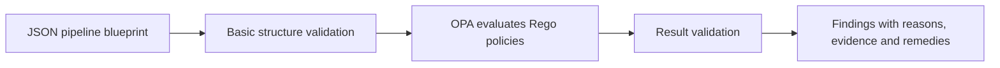

# InspectR

### Design-time architectural compliance inspection for data pipelines

InspectR is a research prototype for inspecting planned data pipelines against explicitly encoded organizational compliance policies.

The tool evaluates a machine-readable pipeline blueprint using Policy-as-Code (PaC) and produces findings with reasons, supporting blueprint evidence, and remediation guidance.

InspectR is being developed as the artifact of an MSc thesis in Systems Architecture at the University of Oslo, in collaboration with SINTEF. The thesis uses Design Science Research (DSR), with development and evaluation grounded in the DataPACT MUNDAT municipal data-sharing use case involving Trondheim Kommune.

> **Status:** Early-stage research prototype. As of October 2026, artifact development has been underway for approximately four weeks. The current proof of concept establishes an initial implementation baseline; it does not represent the final scope of InspectR or the completed thesis. Thesis submission is planned for the end of May 2027.

> Assurance boundary: InspectR currently checks what a pipeline blueprint declares. It does not establish that controls have been implemented, that they operate successfully at runtime, or that an organization or processing activity is legally compliant.

## Contents

- [Research context and project phase](#research-context-and-project-phase)
- [Purpose and scope](#purpose-and-scope)
- [MUNDAT use case](#mundat-use-case)
- [Current architecture](#current-architecture)
- [Pipeline blueprint](#pipeline-blueprint)
- [Metadata catalogue and evidence](#metadata-catalogue-and-evidence)
- [Current policy checks](#current-policy-checks)
- [Interpreting results](#interpreting-results)
- [Example evaluation](#example-evaluation)
- [Research and evaluation](#research-and-evaluation)
- [Limitations](#limitations)
- [Running the prototype](#running-the-prototype)
- [Repository structure](#repository-structure)
- [Terminology](#terminology)

## Research context and project phase

InspectR investigates how selected compliance expectations can be represented as inspectable properties of a planned pipeline and evaluated before deployment.

The thesis combines artifact development with evaluation in a real project context. SINTEF’s collaboration provides the setting for developing InspectR and validating it against the DataPACT MUNDAT use case.

The current repository documents an initial proof of concept:

- A JSON blueprint representing a municipal data-sharing workflow.
- Six selected policy checks implemented in Rego.
- Policy evaluation through Open Policy Agent (OPA).
- A Streamlit interface for uploading a blueprint and viewing findings.
- Explicit boundaries on what those findings establish.

The scientific contribution, final artifact scope, and evaluation results remain under development. The existence of a working prototype does not, by itself, establish research novelty, general applicability, or practical effectiveness.

This README describes the current implementation. Future capabilities should not be inferred from the broader research motivation.

## Purpose and scope

InspectR supports review of a planned pipeline by asking whether selected controls are represented in its design metadata.

Examples include:

- Is a DPIA checkpoint declared when the encoded policy trigger is present?
- Is a risk-assessment checkpoint declared for special-category data?
- Is a data-sharing agreement checkpoint represented?
- Does an integration step declare a lineage record?
- Is purpose compatibility explicitly declared?
- Are the selected sharing safeguards represented in the blueprint?

These questions are narrower than determining legal compliance.

### What InspectR currently does

- Accepts a JSON pipeline blueprint.
- Performs basic input-structure validation.
- Evaluates the blueprint directly against six OPA/Rego policy checks.
- Validates and displays the returned findings.
- Presents reasons, evidence, and remediation guidance.

### What InspectR does not currently establish

- Whether a DPIA has been performed or is adequate.
- Whether a sharing agreement exists, is signed, or is legally sufficient.
- Whether a declared purpose is legally compatible.
- Whether anonymisation prevents re-identification.
- Whether catalogue or lineage records are complete and accurate.
- Whether declared encryption or other controls operate at runtime.
- Whether the organization complies with all applicable obligations.

InspectR supports design review. It does not replace legal interpretation, authorized approval, document review, or runtime assurance.

## MUNDAT use case

MUNDAT concerns the efficient and compliant sharing of municipal data by Trondheim Kommune.

A data consumer requests information for purposes such as research, public services, or innovation. The municipality must identify relevant sources, assess risks, prepare and protect the data, approve sharing, and deliver the resulting dataset.

The use-case workflow includes:

1. Receiving and assessing a data request.
2. Identifying relevant systems and datasets.
3. Considering DPIA and risk-assessment needs.
4. Extracting and integrating data.
5. Applying appropriate data-protection measures.
6. Assessing sharing conditions.
7. Delivering the dataset securely.

InspectR does not implement this entire operational workflow. The current PoC inspects selected design properties associated with it.

### Current example scenario

The example blueprint is:

```text
data/tk_mundat_data_sharing_v2.json
```

It is built using the inLUMEN pipeline designer and represents the following planned workflow:

```text
request
  → classify_request
  → dpia_check
  → extract_data
  → integrate_dataset
  → anonymisation
  → sharing_assessment
  → share_dataset
```

The blueprint includes declarations concerning:

- Personal and special-category data.
- Schema fields, PII markers, and masking strategies.
- Storage, encryption, and retention.
- DPIA and risk-assessment checkpoints.
- Catalogue, lineage, and provenance references.
- Anonymisation.
- Purpose, recipient, agreement, and contractual conditions.
- Transfer encryption and audit trails.

The MUNDAT description identifies Sickleave and IoT stormwater-sensor datasets. The current example focuses on a sensitive-data-sharing scenario associated with Sickleave; it does not model the IoT scenario.

The blueprint uses source-node identifiers such as `health_services` and `citizen_registry`. These identify elements of the example model. They should not be interpreted as independently verified descriptions of Trondheim Kommune’s operational source systems.

## Current architecture



The current evaluation sequence is:

1. A user uploads a JSON blueprint.
2. InspectR checks the expected top-level structure, including the `pipeline` object and `pipeline.nodes` list.
3. InspectR sends the blueprint directly to OPA.
4. OPA evaluates the policies in `policies/tk/`.
5. InspectR validates and displays one result for each policy check.

The current PoC does not use an intermediate representation.

The interface is implemented in Streamlit. Input validation, OPA execution, and result validation are handled by the evaluator.

## Pipeline blueprint

A blueprint is a machine-readable description of a planned pipeline.

The broader concept may encompass different pipeline representations. However, the current InspectR input is the JSON blueprint described here. Native inspection of Argo YAML, Python pipelines, or other formats is not established by this PoC.

### Architectural metadata layers

The example combines three kinds of information:

| Layer | Information represented |
|---|---|
| Data schema | Fields, types, sensitivity classifications, and protection metadata. |
| Pipeline manifest | Activities, purposes, destinations, dependencies, and checkpoints. |
| Infrastructure / IaC metadata | Hosting, storage, encryption, retention, and deployment properties. |

These are architectural information categories represented together in the example JSON. They do not imply that the current application automatically extracts or merges separate schema, manifest, and IaC files.

### Nodes and connections

The blueprint contains a `pipeline` object with:

- Nodes: sources, activities, controls, gates, and destinations.
- Connections: relationships representing data, control, authorization, or approval flows.

A node has an identifier, a type, and properties:

```json
{
  "id": "dpia_check",
  "type": "compliance_gate",
  "properties": {
    "dpia_checkpoint_defined": true,
    "risk_assessment_checkpoint_defined": true
  }
}
```

The current policy descriptions primarily concern node types and declared properties. The presence of connections in the blueprint should not be interpreted as a claim that all-path coverage, execution ordering, or safeguard-bypass analysis is currently implemented.

### Meaning of declared values

Blueprint values describe the design, not completed operational activities.

| Value | Design-time meaning |
|---|---|
| `true` | The design declares the named checkpoint or control. |
| `false` | The design explicitly declares that the checkpoint or control is absent. |
| Missing or `null` | The design does not supply the information. |

For example:

```json
"dpia_checkpoint_defined": true
```

means that a DPIA checkpoint is represented in the design. It does not mean that a DPIA has been completed or approved.

The treatment of missing information varies between the current rules. The prototype does not yet provide a uniform uncertainty outcome across all checks.

## Metadata catalogue and evidence

The blueprint includes references intended to connect design declarations with catalogue, dataset, lineage, and provenance records.

Examples include:

```text
catalog:trondheim-mundat
dataset:health-services
dataset:citizen-registry
lineage:tk-mundat-sickleave-v2
provenance:tk-mundat-sickleave-v2
```

These references support traceability within the modeled design.

However, a reference or Boolean declaration is not equivalent to independent verification of the referenced artifact.

In particular, the current TK-004 check evaluates:

```text
lineage_record_defined
```

It does not establish that the referenced record exists, is complete, or accurately describes the pipeline.

Within the current PoC, “evidence” means the blueprint values or calculated facts used to explain a finding. It does not necessarily mean independently reviewed documentary or runtime evidence.

## Current policy checks

The six checks operationalize selected policy expectations for the example scenario. They are not a comprehensive encoding of GDPR, the AI Act, or all MUNDAT requirements.

Policy-source mappings, stakeholder validation, and coverage must be documented and evaluated as part of the thesis. The policy identifiers alone do not establish legal authority or completeness.

| ID | Check | Current inspection |
|---|---|---|
| TK-001 | DPIA checkpoint | Detects a source declaring both personal and special-category data and checks for a DPIA checkpoint declaration. |
| TK-002 | Risk-assessment checkpoint | Detects declared special-category data and checks for a risk-assessment checkpoint declaration. |
| TK-003 | Data-sharing agreement checkpoint | Detects declared personal data together with a transfer node and checks for an agreement checkpoint declaration. |
| TK-004 | Lineage-record declaration | Checks the `lineage_record_defined` property on integration nodes. |
| TK-005 | Purpose-compatibility declaration | Checks compliance-gate declarations and escalates missing or non-true values to human review. |
| TK-006 | Sharing safeguards | Checks five specified control declarations on the named workflow nodes. |

### TK-006 checklist

TK-006 requires all of the following values to be exactly `true`:

```text
dpia_check.dpia_checkpoint_defined
dpia_check.risk_assessment_checkpoint_defined
sharing_assessment.data_sharing_agreement_checkpoint_defined
sharing_assessment.recipient_approval_checkpoint_defined
share_dataset.encryption_in_transit_configured
```

Any missing, `null`, or non-true value produces `FAIL`.

This rule is tied to the current workflow’s node identifiers and is not presented as a format-independent inspection of arbitrary architectures.

## Interpreting results

| Result | Meaning in the current prototype |
|---|---|
| `PASS` | The rule’s encoded condition is satisfied, or its triggering condition is not detected. |
| `FAIL` | The rule identifies a condition treated as a violation of the encoded design expectation. |
| `HUMAN` | The rule requests human review rather than making an automated determination. |

Not every rule produces every result.

### Rule-specific behavior

| Rules | Documented outcome behavior |
|---|---|
| TK-001–TK-003 | Pass when the relevant declaration is true or the trigger is not detected; fail for the documented explicitly false checkpoint condition. |
| TK-004 | Pass for a declared lineage record or no integration node; fail for an explicitly false lineage declaration. |
| TK-005 | Request human review when any compliance gate lacks an exactly true purpose-compatibility declaration; pass when its documented conditions are satisfied, including when no gates exist. |
| TK-006 | Pass only when all five specified controls are exactly true; otherwise fail. |

The TK-001–TK-004 descriptions do not exhaustively specify every combination of absent values or conflicting declarations. Their executable Rego definitions determine implementation behavior; additional cases should be documented through tests.

A `PASS` must not be read as a compliance certificate. It can also mean that a rule was not triggered, which is different from finding affirmative evidence of a control.

`HUMAN` is currently produced only by TK-005. It is an evaluation outcome, not a claim that the application implements a complete human-review or approval workflow.

## Example evaluation

The documented result for the current v2 example is:

| Rule | Result | Interpretation |
|---|---|---|
| TK-001 | `PASS` | The DPIA checkpoint is declared. |
| TK-002 | `PASS` | The risk-assessment checkpoint is declared. |
| TK-003 | `PASS` | The agreement checkpoint is declared for the modeled transfer scenario. |
| TK-004 | `PASS` | The integration design declares a lineage record. |
| TK-005 | `HUMAN` | A compliance gate lacks a purpose-compatibility declaration. |
| TK-006 | `PASS` | All five specified safeguard declarations are true. |

This example demonstrates prototype behavior. It is not, by itself, a scientific evaluation of effectiveness, usability, generalizability, or legal adequacy.

## Research and evaluation

InspectR is being developed using Design Science Research.

The research direction is to investigate how selected compliance expectations can be represented, inspected, and explained during pipeline design.

Evaluation against the MUNDAT case is part of the thesis work. The README does not claim that stakeholder validation or a completed empirical evaluation has already taken place.

Research questions, contribution claims, and evaluation scope remain subject to refinement with the academic supervisors, SINTEF, and relevant case stakeholders.

Relevant evaluation questions include:

- Do the policies faithfully represent the selected case requirements?
- Does the blueprint provide sufficient information for those checks?
- How does inspection behave when information is missing or inconsistent?
- Do stakeholders correctly understand the findings and their limitations?
- What effort is required to prepare the metadata and review the results?
- Which aspects of the approach transfer beyond the example blueprint?

These are research questions to investigate, not capabilities or benefits already demonstrated.

## Limitations

The current PoC has the following boundaries:

- It depends on the accuracy and completeness of supplied metadata.
- It evaluates selected declarations rather than operational behavior.
- It covers six scoped policy checks, not all applicable obligations.
- It does not read or interpret legislation automatically.
- It does not verify the adequacy of DPIAs, agreements, or anonymisation.
- It does not establish catalogue or lineage-record correctness.
- Its result semantics differ between rules.
- Some checks depend on scenario-specific node identifiers.
- It does not establish comprehensive graph-path or ordering analysis.
- It does not include an intermediate representation.
- Its documented execution setup is Windows-specific.
- Its research contribution and practical effectiveness remain under evaluation.

## Running the prototype

### Requirements

- Windows.
- Python.
- Dependencies listed in `requirements.txt`.
- OPA installed at:

```text
C:\Tools\OPA\opa.exe
```

### Start the application

Run from the repository root:

```powershell
.\.venv\Scripts\Activate.ps1
pip install -r requirements.txt
streamlit run app.py
```

Open the Evaluation page, upload a JSON blueprint, and select Run InspectR.

The activation command assumes that a virtual environment already exists at `.venv`.

## Repository structure

| Path | Purpose |
|---|---|
| `app.py` | Streamlit configuration and navigation. |
| `pages/evaluation.py` | Blueprint upload, evaluation, and result presentation. |
| `src/evaluator.py` | Input validation, OPA execution, and result validation. |
| `policies/tk/` | Current MUNDAT Rego policies. |
| `data/` | Example blueprints and taxonomy data. |
| `tk-uc/` | MUNDAT source material. |

## Terminology

| Term | Meaning in InspectR |
|---|---|
| Blueprint | Machine-readable representation of a planned pipeline; currently JSON. |
| Policy | An encoded organizational interpretation of a selected requirement. |
| Compliance gate | A checkpoint represented in the planned workflow. |
| Design declaration | Metadata stating that a control or checkpoint is included in the design. |
| Design-time inspection | Evaluation of the blueprint before pipeline execution. |
| Evidence | Blueprint values or calculated facts supporting a finding. |
| Finding | A policy-evaluation result with an explanation and remediation guidance. |
| OPA | Open Policy Agent, the policy-evaluation engine. |
| Rego | The language used to implement the current policies. |
| Runtime assurance | Evidence concerning actual execution or control operation; outside the current PoC. |

---

MSc thesis research prototype · University of Oslo · Collaboration with SINTEF  
Case context: DataPACT MUNDAT, Trondheim Kommune  
Thesis submission planned: May 2027
