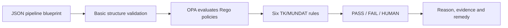

# InspectR

### Design-time compliance inspection for data-pipeline blueprints

InspectR checks whether a planned data pipeline contains the compliance controls
that its organisation expects **before the pipeline is deployed**.

This version is a proof of concept (PoC) for the TK/MUNDAT municipal data-sharing case. InspectR
uses a JSON blueprint, Open Policy Agent (OPA), and Rego policy rules to produce
clear, evidence-based findings.

> **Important:**
> InspectR checks and can verify what the pipeline structure declares. It does **not** prove that a control works at runtime or that the organisation is compliant.

### Core definitions

| Term | Definition |
| --- | --- |
| **Blueprint** | A machine-readable description of a planned data pipeline. |
| **Compliance gate** | A checkpoint that must be completed before a sensitive activity continues. |
| **Connection** | A link between two nodes showing how data, control or approval moves. |
| **Data source** | A system or dataset from which the pipeline reads data. |
| **Design-time compliance** | Checking a planned architecture before deployment or execution. |
| **Evidence** | A blueprint value or calculated fact used to support a compliance result. |
| **Infrastructure metadata** | Information about storage, hosting, encryption and retention. |
| **Node** | One component or activity in the pipeline graph. |
| **OPA** | Open Policy Agent: the engine that evaluates policy rules against input data. |
| **Policy** | An organisational interpretation of a legal or governance requirement. |
| **Rego** | The policy language used to write rules for OPA. |
| **Runtime compliance** | Checking what happens while a pipeline is operating. |
| **Static inspection** | Analysis of a document or design without running the pipeline. |

## 1. The nature of data pipelines

A data pipeline is a planned route for data:

```text
request -> identify sources -> extract -> integrate -> protect -> approve -> share
```

For example, a municipality may receive a request to combine HR data from
several systems, remove identifying information, and share a research dataset.
The pipeline blueprint describes this planned route before implementation.

### How the TK-blueprint is built

The blueprint is a JSON document containing a `pipeline` object. The pipeline
has two main parts:

1. **Nodes** — the activities, systems, data sources and control points.
2. **Connections** — the edges between nodes that describe data, control,
   authorisation or approval flows.

Each node has an `id`, a `type`, and `properties`:

```json
{
  "id": "dpia_check",
  "type": "compliance_gate",
  "properties": {
    "dpia_completed": true,
    "risk_assessment_completed": true
  }
}
```

### What the blueprint can describe

| ELEMENT | What it describes | Example |
| --- | --- | --- |
| **Node** | A step, system, source or control in the pipeline | `extract_data` |
| **Node ID** | The unique name used to refer to a node | `health_services` |
| **Node type** | The role of the node | `data_source`, `data_transfer` |
| **Properties** | Facts and declarations about the node | `contains_personal_data: true` |
| **Data source** | A system or dataset entering the pipeline | HR or citizen registry |
| **Data processing** | An operation performed on data | Extraction or cleaning |
| **Data integration** | Combining or harmonising data from sources | Joining datasets |
| **Privacy control** | A protection step applied to data | Anonymisation |
| **Compliance gate** | A decision or control point before continuing | DPIA or sharing approval |
| **Data transfer** | A planned delivery or export of data | Open-data portal |
| **Infrastructure metadata** | Where and how data is stored | Storage provider, encryption |
| **Schema metadata** | The fields and sensitivity of a dataset | `employee_id` is PII |
| **Connection / edge** | A relationship between two nodes | `from: extract_data` to `integrate_dataset` |
| **Evidence property** | A value that a policy can inspect | `lineage_available: true` |

## 2. InspectR flow



In simple terms:

1. The user uploads a JSON blueprint.
2. InspectR checks that it contains a valid `pipeline` and `pipeline.nodes` list.
3. InspectR sends the blueprint directly to OPA.
4. OPA applies the Rego rules in [`policies/tk/`](./policies/tk/).
5. InspectR validates and displays one result for each rule.

No intermediate representation is used in this proof of concept.


## 3. The MUNDAT case

MUNDAT is a Trondheim municipal data-sharing use case. A data consumer requests
data for research, public services or innovation. The municipality must identify
the relevant systems, assess risks, extract and combine data, protect sensitive
information, approve the sharing, and deliver the result securely.

The original use case includes activities such as:

- receiving and assessing a data request;
- identifying relevant data sources;
- performing DPIA and risk assessments;
- extracting and integrating data;
- anonymising or otherwise protecting sensitive data;
- checking purpose, recipient and contractual conditions;
- sharing the final dataset securely.

### InspectR's specific focus

MUNDAT can be interpreted in many ways. This project focuses specifically on:

> **Automating compliance checks at design time, using metadata in a planned data
> pipeline.**

InspectR does not implement the whole MUNDAT operational process. It demonstrates
how selected compliance expectations can be translated into inspectable blueprint
properties and Rego rules.

### The example blueprint

[`data/tk_mundat_data_sharing_v2.json`](./data/tk_mundat_data_sharing_v2.json)
models this flow:

```text
request
  -> classify_request
  -> dpia_check
  -> extract_data
  -> integrate_dataset
  -> anonymisation
  -> sharing_assessment
  -> share_dataset
```

It includes:

- two data sources: `health_services` and `citizen_registry`;
- personal-data and special-category-data declarations;
- schema fields, PII markers and masking strategies;
- storage, encryption and retention metadata;
- DPIA and risk-assessment properties;
- an integration node with lineage and provenance properties;
- an anonymisation step;
- purpose, contract, recipient and agreement properties;
- transfer encryption and audit-trail properties.

## 4. The six compliance rules

The rules do not read legal documents or inspect the running pipeline. They
inspect the structure and properties declared in the blueprint.

### Result meanings

| Result | Meaning |
| --- | --- |
| **PASS** | The expected control is declared, or the rule is not applicable. |
| **FAIL** | A required control is explicitly false or missing under that rule's logic. |
| **HUMAN** | The available metadata is not enough for a safe automated decision. |

### TK-001 — DPIA required

**What it checks:** Whether sensitive personal-data processing has a completed
DPIA.

**Logic:**

```text
personal data + special-category data
        -> DPIA required
        -> dpia_completed must be true
```

| Scenario | Result |
| --- | --- |
| A source contains personal and special-category data, and a gate says `dpia_completed: true`. | **PASS** |
| A source contains personal and special-category data, and a gate says `false`. | **FAIL** |
| No data source is marked as both personal and special-category data. | **PASS** because this rule sees no DPIA trigger. |

**What PASS proves:** The blueprint declares the DPIA control. It does not
verify the DPIA's content or quality.

### TK-002 — Risk assessment

**What it checks:** Whether special-category data has a completed risk assessment.

**Logic:**

```text
special-category data present
        -> risk assessment required
        -> risk_assessment_completed must be true
```

| Scenario | Result |
| --- | --- |
| Special-category data exists and the gate says `risk_assessment_completed: true`. | **PASS** |
| Special-category data exists and the gate says `false`. | **FAIL** |
| No source is marked as containing special-category data. | **PASS** because this rule is not triggered. |

**What PASS proves:** The blueprint declares a completed risk assessment. It
does not review the assessment itself.

### TK-003 — Data-sharing agreement

**What it checks:** Whether personal data is transferred under a declared
data-sharing agreement.

**Logic:**

```text
personal data + data transfer
        -> agreement required
        -> data_sharing_agreement_exists must be true
```

| Scenario | Result |
| --- | --- |
| Personal data is transferred and a gate says an agreement exists. | **PASS** |
| Personal data is transferred and a gate says no agreement exists. | **FAIL** |
| There is no personal-data transfer. | **PASS** because this rule is not triggered. |

**What PASS proves:** The blueprint declares that an agreement exists. It does
not verify signatures, content, roles or legal validity.

### TK-004 — Data lineage

**What it checks:** Whether an integration step declares that data lineage is
available.

**Logic:**

```text
data integration node exists
        -> lineage_available must be true
```

| Scenario | Result |
| --- | --- |
| An integration node says `lineage_available: true`. | **PASS** |
| An integration node says `lineage_available: false`. | **FAIL** |
| No integration node is declared. | **PASS** because this rule is not triggered. |

**What PASS proves:** The blueprint declares lineage availability. It does not
inspect whether the lineage records are complete or accurate.

### TK-005 — Purpose compatibility

**What it checks:** Whether the declared purpose decision is clear enough to
accept automatically.

**Logic:**

```text
purpose_compatible is missing, null or not true
        -> HUMAN review

purpose_compatible is true
        -> PASS
```

| Scenario | Result |
| --- | --- |
| A compliance gate explicitly says `purpose_compatible: true`. | **PASS** |
| The value is missing, null or false. | **HUMAN** |
| No compliance gates exist. | **PASS** because no purpose gate is declared. |

**Why HUMAN exists:** Purpose compatibility depends on context, legal basis,
original purpose, new purpose and organisational judgement. A Boolean field alone
cannot replace that review.

### TK-006 — Complete sharing safeguards

**What it checks:** Five fixed controls in the sharing workflow:

1. `dpia_check.dpia_completed`
2. `dpia_check.risk_assessment_completed`
3. `sharing_assessment.data_sharing_agreement_exists`
4. `sharing_assessment.recipient_approved`
5. `share_dataset.encrypted_in_transit`

**Logic:**

```text
all five values are exactly true -> PASS
any value is false or missing    -> FAIL
```

| Scenario | Result |
| --- | --- |
| All five controls are `true`. | **PASS** |
| One or more controls are `false` or missing. | **FAIL** |

**What PASS proves:** The blueprint declares all five safeguards. It does not
test whether the safeguards operate in reality.

## 5. Example evaluation

When the example v2 blueprint is evaluated, the current results are:

| Rule | Result | Simple explanation |
| --- | --- | --- |
| TK-001 | **PASS** | Sensitive data is present and DPIA completion is declared. |
| TK-002 | **PASS** | Risk-assessment completion is declared. |
| TK-003 | **PASS** | Personal-data transfer and a sharing agreement are declared. |
| TK-004 | **PASS** | The integration node declares available lineage. |
| TK-005 | **HUMAN** | One compliance gate has no purpose-compatibility value, so review is required. |
| TK-006 | **PASS** | All five required sharing safeguards are declared as true. |

## 6. Running InspectR

### Requirements

- Windows
- Python
- The packages in [`requirements.txt`](./requirements.txt)
- OPA installed at `C:\Tools\OPA\opa.exe`

### Start the application

Run from the repository root:

```powershell
.\.venv\Scripts\Activate.ps1
pip install -r requirements.txt
streamlit run app.py
```

Then open the **Evaluation** page, upload a JSON blueprint, and select
**Run InspectR**.

### Validate the implementation

```powershell
python -m py_compile app.py src\evaluator.py pages\evaluation.py
```

Evaluate the example directly with OPA:

```powershell
Get-Content -Raw data\tk_mundat_data_sharing_v2.json |
  C:\Tools\OPA\opa.exe eval --format=json `
    --data policies\tk `
    --stdin-input data.inspectr.results
```

Run commands from the repository root because policy and asset paths are
relative to the current working directory.

## 7. Repository structure

| Path | Purpose |
| --- | --- |
| [`app.py`](./app.py) | Streamlit configuration and navigation |
| [`pages/evaluation.py`](./pages/evaluation.py) | Upload, evaluation and result display |
| [`src/evaluator.py`](./src/evaluator.py) | Input validation, OPA execution and result validation |
| [`policies/tk/`](./policies/tk/) | Active TK/MUNDAT Rego policies |
| [`data/`](./data/) | Example blueprints and taxonomy data |
| [`tk-uc/`](./tk-uc/) | TK/MUNDAT source material |

## 8. Scope and limitations

InspectR provides **design-time evidence**, not a complete compliance
certificate. A PASS does not prove that:

- a DPIA or risk assessment is complete or adequate;
- a data-sharing agreement is legally valid;
- a purpose is genuinely compatible;
- anonymisation prevents re-identification;
- lineage records are complete;
- encryption or other controls work at runtime.

Human review, document verification and runtime controls are still required.
