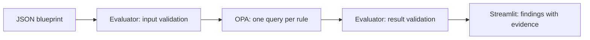

# InspectR

Design-time compliance inspection of data-pipeline blueprints with Policy-as-Code (OPA/Rego).

MSc thesis artefact (Design Science Research), Department of Informatics, University of Oslo, in collaboration with SINTEF within DataPACT. Case: MUNDAT, Trondheim Kommune (TK). Status: iteration 1 proof of concept, rule set `tk-v2.0`.

> **Assurance boundary.** InspectR checks what a blueprint *declares* against encoded interpretations of selected requirements. It does not establish legal compliance, completed assessments or approvals, or the runtime behaviour of controls. The rules are author interpretations and have not yet been reviewed by SINTEF, TK or legal experts.

## Problem

Compliance requirements for data pipelines (for example GDPR obligations in the TK documents) are written in natural language and are checked manually, late, and without traceability to the pipeline design. Pipeline tooling exports structure, but not the compliance facts a check needs. InspectR investigates how selected requirements can be made machine-checkable against a pipeline blueprint before deployment.

## Research questions

**Main RQ.** How can a design-time policy engine be architected to inspect compliance properties of data/AI pipeline blueprints in a way that is traceable, reliable and independent of the use case and pipeline tool?

| RQ | Focus |
|---|---|
| RQ1 · Evidence model | What compliance-relevant information must a blueprint contain for policy-based inspection, and how much can pipeline tooling derive versus manual annotation? |
| RQ2 · Architecture | Which architectural design supports reuse across use cases and blueprint formats (intermediate representation with adapters, policy packs, explicit result semantics)? |
| RQ3 · Evaluation | How reliable, explainable and efficient are InspectR's findings compared with manual expert review, across DataPACT use cases? |

## Method: from requirement to verdict

```text
Requirement (TK / GDPR, natural language)
  → Rule        IF trigger THEN control
  → Facts       blueprint fields the rule reads: true | false | undetermined
  → Evaluation  OPA applies the rule's decision table to the facts
  → Result      one status + reason + evidence + remedy
```

A fact is **undetermined** when the blueprint gives no usable evidence for it (absent, null, or not a boolean). Every rule follows the same decision table:

| Trigger | Control | Status |
|---|---|---|
| undetermined | any | UNKNOWN |
| false | any | NOT_APPLICABLE |
| true | false | FAIL |
| true | undetermined | UNKNOWN |
| true | true | PASS (HUMAN for judgement rules) |

ERROR is outside the table: InspectR failed, not the blueprint. An undetermined fact never produces PASS.

### Status model

| Status | Meaning | Who acts next |
|---|---|---|
| PASS | The obligation applies and every required control is declared `true`. | Nobody (design level only) |
| FAIL | The obligation applies and a required control is declared `false`. | Designer: add the control |
| UNKNOWN | A fact the rule needs is undetermined. | Designer or tool: supply the fact |
| HUMAN | Everything checkable is declared; the final decision is a legal judgement. | Legal or domain expert |
| NOT_APPLICABLE | The trigger facts are declared `false`; the obligation does not apply. | Nobody |
| ERROR | The rule could not be evaluated. Not a finding about the blueprint. | InspectR developer |

PASS is not a compliance certificate: it means the design declares the control.

## Rule set tk-v2.0

| Rule | TK requirement | Trigger | Control | Legal reference |
|---|---|---|---|---|
| TK-R1 · DPIA and risk-assessment checkpoint | DPIA / risk assessment | A `data_source` declares `contains_special_category_data: true`. | One `compliance_gate` declares `dpia_checkpoint_defined` and `risk_assessment_checkpoint_defined` as `true`. | GDPR Art. 35(1), 35(3)(b), Art. 9 |
| TK-R2 · Lineage record for integrated data | Traceability | A `data_integration` node exists. | Every integration node declares `lineage_record_defined: true`. | GDPR Art. 5(2), Art. 30 |
| TK-R3 · Purpose compatibility before sharing | Lawfulness | A `data_transfer` node exists and a source declares `contains_personal_data: true`. | Gates carrying `purpose_compatibility_declared` declare `true`. Best outcome is HUMAN, never PASS. | GDPR Art. 5(1)(b), Art. 6(4) |

TK-R1 merges v1 rules TK-001 and TK-002; TK-R2 replaces TK-004; TK-R3 replaces TK-005. TK-003 and TK-006 were dropped. Each rule's decision table is in the header of its Rego file. Reasons and fixes: [`docs/RULESET-V2-CHANGES.md`](docs/RULESET-V2-CHANGES.md).

## Case: TK / MUNDAT

The **Sickleave** scenario (DataPACT D5.1 §3.7) assembles a research dataset from health-services and citizen-registry sources, integrates and anonymises it, and shares it with an external recipient. It involves special-category health data, integration of sources, and sharing for a new purpose.

| Blueprint | Content | Role |
|---|---|---|
| `tk-uc/inlumen-tk-uc.json` | Raw inLUMEN export: 7 nodes, generic `kind` (source, task, destination), empty `parameters`. | Shows what tooling exports today. |
| `data/tk_mundat_data_sharing_v2.json` | Enriched blueprint: 11 typed nodes, 13 connections, compliance facts added manually. | Evaluation input. |

The difference between the two is a research finding (RQ1): it measures the gap between what pipeline tooling exports and what inspection needs. Source names, schemas and configuration values in V2 are illustrative modelling assumptions, not confirmed municipal system details.

## Architecture



| Component | Responsibility |
|---|---|
| `policies/tk/*.rego` | Rules as decision tables; manifest in `policy.rego`; shared fact helpers in `lib.rego`. |
| `src/evaluator.py` | Validates input, queries each rule separately, validates results, isolates failures as ERROR. |
| `src/catalog.py` | Single source of truth for rules, statuses and descriptions shown in the app. |
| `src/scenarios.py` | Controlled scenarios S0–S6 with expected statuses. |
| `app.py`, `pages/` | Streamlit app: Overview, Method, Case, Inspect, Validation. |

Every result carries `rule`, `status`, `legal_reference`, `reason`, `evidence`, `remedy`. A failing rule returns ERROR while the other results are kept. Planned (RQ2): an intermediate representation with adapters, so native tool exports can be inspected without manual enrichment.

## Validation

**Scenario matrix.** Each scenario changes one fact in V2; the expected status follows from the decision table. All 21 results match.

| Scenario | TK-R1 | TK-R2 | TK-R3 |
|---|---|---|---|
| S0 · Enriched blueprint (V2) | PASS | PASS | HUMAN |
| S1 · DPIA checkpoint declared false | FAIL | PASS | HUMAN |
| S2 · DPIA checkpoint field removed | UNKNOWN | PASS | HUMAN |
| S3 · Special-category flag removed | UNKNOWN | PASS | HUMAN |
| S4 · No special-category data | NOT_APPLICABLE | PASS | HUMAN |
| S5 · Purpose compatibility declared false | PASS | PASS | FAIL |
| S6 · Raw inLUMEN export (not enriched) | UNKNOWN | NOT_APPLICABLE | NOT_APPLICABLE |

**Tests.** 29 Rego unit tests (`opa test`) cover every decision-table row. 20 pytest integration tests run real OPA on blueprints. They cover the baseline, regression tests for the v1 defects, malformed input, ERROR isolation, catalogue/Rego consistency, and scenarios S0–S6.

**Defects found in v1 and fixed.**

| ID | Defect | Fix |
|---|---|---|
| D1 | One missing field made the whole result list undefined. | UNKNOWN row in every rule; one query per rule; ERROR isolated. |
| D2 | A missing trigger produced a false PASS. | Undetermined trigger gives UNKNOWN. |
| D3 | TK-005 returned HUMAN for the wrong reason. | TK-R3 reads only gates that carry the field. |
| D4 | Vacuous PASS with evidence not in the blueprint. | NOT_APPLICABLE or UNKNOWN; evidence lists only what was examined. |
| D5 | OPA called at a fixed Windows path. | `OPA_PATH`, then `PATH`, then the old path. |

**PoC acceptance criteria.**

| ID | Criterion | Status |
|---|---|---|
| AC1 | Native inLUMEN export accepted through an adapter. | Open |
| AC2 | Policy packs for three use cases without engine changes. | Open |
| AC3 | Every finding has rule ID, status, reference, evidence, reason, remedy. | Met |
| AC4 | Uniform result semantics; missing information gives UNKNOWN, never PASS. | Met |
| AC5 | `opa test` cases for pass, fail, missing and not-applicable per rule. | Met |
| AC6 | Reproducible through Docker and CLI, deterministic output. | Partial (no Docker image) |
| AC7 | Domain expert review of a policy sample. | Open |

## Limitations

The rules are unreviewed interpretations; legal references are not validated mappings. InspectR reads declared properties only. It does not follow graph paths or checkpoint ordering, resolve catalogue references, or verify assessments, agreements, anonymisation or runtime controls. The raw inLUMEN export uses `kind` instead of `type` and has no compliance facts, so it cannot pass any rule until an adapter exists. Only one use case (TK) is encoded.

## Open questions for SINTEF

1. Is three rules acceptable for iteration 1, or should TK-003 (data-sharing agreement) return as TK-R4?
2. Should a design with special-category data and no compliance gate be FAIL (current) or UNKNOWN?
3. Can inLUMEN export node type and the compliance fields, or is an adapter on the InspectR side preferred?
4. Who at SINTEF or TK can review the three rules for fidelity (AC7)?

## Documentation / Wiki

The project wiki lives in [`docs/wiki/`](docs/wiki/README.md) as Markdown files:

- [Wiki home / overview](docs/wiki/README.md)
- [1 · Getting started](docs/wiki/01-getting-started.md)
- [2 · Architecture](docs/wiki/02-architecture.md)
- [3 · Policy engine (`src/`)](docs/wiki/03-policy-engine.md)
- [4 · Rego policies (`policies/tk/`)](docs/wiki/04-rego-policies.md)
- [5 · Streamlit app](docs/wiki/05-streamlit-app.md)
- [6 · Data and blueprints](docs/wiki/06-data-and-blueprints.md)
- [7 · Testing and tooling](docs/wiki/07-testing-and-tooling.md)
- [8 · Glossary](docs/wiki/08-glossary.md)

## Running

Requirements: Python 3.12, the packages in `requirements.txt`, and OPA ≥ 1.0. The evaluator finds OPA via `OPA_PATH`, then `opa` on `PATH`, then `C:\Tools\OPA\opa.exe`.

```powershell
.\.venv\Scripts\Activate.ps1
python -m pip install -r requirements.txt pytest
streamlit run app.py
```

```powershell
C:\Tools\OPA\opa.exe test policies\tk -v          # 29 Rego tests
python -m pytest tests -v                         # 20 integration tests
Get-Content -Raw data\tk_mundat_data_sharing_v2.json |
  C:\Tools\OPA\opa.exe eval --format=pretty --data policies\tk --stdin-input data.inspectr.results
```

Run from the repository root; paths are relative.

## Repository structure

```text
app.py                     Navigation
pages/                     overview, method, case, inspection, validation
pages/archive/             Pre-v2 pages (not in navigation)
src/                       evaluator, catalog, scenarios, ui
policies/tk/               lib.rego, policy.rego, TK-R1..R3.rego, tests/
tests/                     pytest integration tests
data/                      Raw inLUMEN exports, enriched blueprints, taxonomy
docs/RULESET-V2-CHANGES.md What changed from v1 and why
docs/wiki/                 Project wiki (Markdown)
tk-uc/                     MUNDAT source material
images/                    Figures and logos
```

## Terminology

| Term | Meaning |
|---|---|
| Blueprint | Machine-readable description of a planned pipeline. |
| Trigger | The fact that makes a rule's obligation apply. |
| Obligation | What the requirement demands once triggered. |
| Control | A safeguard in the design intended to meet the obligation. |
| Undetermined | No usable evidence for a fact: absent, null, or not a boolean. |
| Compliance gate | A planned assessment or approval point; declaring it does not establish enforcement. |
| Evidence | The blueprint observations and derived facts a result is based on. |
| Policy-as-Code | Executable representation of policy conditions; here Rego evaluated by OPA. |

---

Sirin Koca · MSc Programming and System Architecture, University of Oslo · Supervisors: Ahmet Soylu, Anis Yazidi (UiO); Dumitru Roman, Adela Nedisan Videsjorden, Arda Goknil (SINTEF) · Planned submission May 2027
