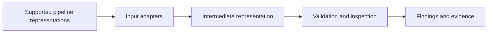

# InspectR

## Compliance-by-design for data pipelines using Policy-as-Code

InspectR is a research prototype for design-time inspection of data-pipeline blueprints. It uses Open Policy Agent (OPA) and Rego to evaluate selected
metadata conditions and present findings with reasons, supporting evidence, and remediation guidance.

A pipeline structure (blueprint) describes how data moves through operations, with dependencies, conditions, and configuration. My research question is: _What information must a pipeline design expose to make a selected requirement machine-checkable?_

> **Status:** Early-stage proof of concept (PoC), October 2026. The current
> implementation establishes an initial baseline, not the final scope of
> InspectR. A broader, standalone architecture incorporating an intermediate
> representation (IR) is planned.

> Assurance boundary: InspectR checks supplied design information against
> encoded policy interpretations. It does not establish legal compliance,
> completed approvals, or the implementation and runtime effectiveness of
> controls.

## Contents

- [Research context](#research-context)
- [Current PoC](#current-poc)
- [Architecture](#architecture)
- [Pipeline blueprint](#pipeline-blueprint)
- [Metadata catalogue and evidence](#metadata-catalogue-and-evidence)
- [Policy checks](#policy-checks)
- [Interpreting findings](#interpreting-findings)
- [Planned architecture and research directions](#planned-architecture-and-research-directions)
- [Evaluation status](#evaluation-status)
- [Limitations](#limitations)
- [Running the prototype](#running-the-prototype)
- [Repository structure](#repository-structure)
- [Terminology](#terminology)

## Research context

InspectR is being developed as an MSc thesis artefact in Systems Architecture
at the University of Oslo, in collaboration with SINTEF within DataPACT.

The thesis follows Design Science Research (DSR). Its broader motivation is
compliance automation for data and AI systems, with an emphasis on
compliance-by-design: identifying relevant design issues before deployment.

The research investigates how selected compliance expectations can be
translated into inspectable architectural information and executable
Policy-as-Code checks. Development and planned case evaluation are grounded
in MUNDAT, the Trondheim Kommune municipal data-sharing use case.

The application, initial policy interpretations, and blueprint enrichment
were developed by the thesis author. The interpretations have not yet been
validated by SINTEF, Trondheim Kommune, or legal reviewers.

Planned submission: May 2027. The final contribution and evaluation scope remain under development.

## Current PoC

The current application supports:

- Uploading a JSON pipeline blueprint and preview.
- JSON parsing and basic input-structure validation.
- Evaluation of six initial Rego checks through OPA.
- Validation of returned result fields and status values.
- Side-by-side presentation of the blueprint metadata and findings.
- Display of policy-provided reasons, evidence, references, and remedies.

The PoC inspects declared node properties. It does not execute pipelines,
inspect actual datasets, enforce runtime decisions, or analyse graph paths.

The current input format is JSON. Native inspection of other pipeline
formats or Infrastructure-as-Code (IaC) files is not implemented.
Infrastructure-related metadata is represented within the example blueprint.

## Architecture

### Current evaluation flow


| Component | Responsibility |
|---|---|
| Streamlit GUI | Upload, interaction, session state, and presentation. |
| InspectR Python evaluator | Structural checks, OPA invocation, response parsing,  result validation. |
| OPA | Execution of Rego policies against the supplied input. |
| Rego policies | Conditions, decision branches, and finding construction. |

InspectR coordinates the inspection workflow; OPA performs policy evaluation.
The current PoC passes the blueprint directly to OPA without an IR.

### Evaluator

`src/evaluator.py` checks that the input contains a `pipeline` object and a
`pipeline.nodes` list. It then invokes the configured OPA executable with:

```text
Policy directory: policies/tk
Query:            data.inspectr.results
```

`policy.rego` aggregates the reports from TK-001–TK-006.

The evaluator requires each returned result to contain:

```text
rule
status
legal_reference
reason
evidence
remedy
```

It validates field presence and permitted status values, not legal accuracy,
evidence correctness, or policy completeness. Execution and response errors
raise exceptions.


## Pipeline blueprint

A blueprint is a machine-readable description of a planned pipeline.

### What can a data-pipeline blueprint describe?

A pipeline blueprint can represent planned activities, data relationships,
configuration, and governance declarations. The information available depends
on the modelling language, designer, and metadata supplied.

The categories below are an organisational overview, not a universal standard
or a list of capabilities currently implemented in InspectR.

| Category | Element | What it describes | Example |
|---|---|---|---|
| Representation structure | Node | A represented activity, system, dataset, control, or destination. | Extraction activity |
| Representation structure | Identifier | An identifier for referencing an element within a defined scope. | `extract_data` |
| Representation structure | Type | The declared category of an element. | `data_source`, `data_transfer` |
| Representation structure | Property | A declared attribute, configuration value, or reference. | `contains_personal_data: true` |
| Representation structure | Connection / edge | A typed relationship between elements, with explicitly defined meaning. | Data flow or execution dependency |
| Data description | Sources and outputs | Systems or datasets consumed or produced by an operation. | HR dataset → aggregated research dataset |
| Data description | Schema | Field names, types, and structural constraints. | `employee_id: string` |
| Data description | Classification | Declared sensitivity or governance classifications of datasets or fields. | Personal data; special-category data |
| Processing and flow | Processing activity | A planned operation and, where specified, its inputs and outputs. | Extraction, filtering, or cleaning |
| Processing and flow | Integration | A planned combination or harmonisation of data. | Joining datasets |
| Processing and flow | Dependencies and conditions | Declared ordering, branching, and conditions for proceeding. | Release depends on approval |
| Processing and flow | Transfer and destination | A planned delivery or publication and its intended endpoint. | Publish an output to an open-data portal |
| Infrastructure and configuration | Deployment and storage

### Example and provenance

```text
data/tk_mundat_data_sharing_v2.json
```

The initial blueprint was created using inLUMEN. V2 was manually enriched
by the thesis author because the initial export lacked metadata required
by the proposed checks.

The intended longer-term workflow is for pipeline representations to
originate from designers or other supported tools. Manual enrichment is
part of the current experiment, not an established production integration.

### MUNDAT scenario

DataPACT Deliverable D5.1, Section 3.7, identifies:

| Dataset | Description |
|---|---|
| Sickleave | Research dataset combining sick-leave registration, work-environment surveys, turnover reports, and HR demographic data. |
| IoT | Stormwater-basin sensor data measuring sand levels. |

V2 models a Sickleave-related scenario and explicitly excludes IoT.

Source identifiers such as `health_services` and `citizen_registry`,
together with their schemas and configuration values, are illustrative
modelling assumptions. They are not confirmed municipal system details
or a validated reproduction of the documented contributing sources.

### Structure and metadata

The example contains nodes and typed connections.

| Element | Meaning |
|---|---|
| Node | A source, activity, checkpoint, control, or destination. |
| Node ID | Identifier used to reference a particular node. |
| Node type | Category used by policies to select relevant nodes. |
| Properties | Metadata and design declarations inspected by policies. |
| Connection | A declared data, control, authorisation, approval, or metadata relationship. |

The blueprint combines:

- Schema metadata: fields, types, PII markers, and masking strategies.
- Pipeline metadata: processing steps, purposes, and checkpoints.
- Infrastructure metadata: storage, encryption, retention, and purge settings.
- References: catalogue, dataset, lineage, and provenance identifiers.

These categories are represented in one JSON document. They are not
automatically extracted from separate schema, manifest, and IaC files.

Not all properties are evaluated by the current policies.

### Design declarations

```json
{
  "id": "dpia_check",
  "type": "compliance_gate",
  "properties": {
    "dpia_checkpoint_defined": true,
    "risk_assessment_checkpoint_defined": true
  }
}
```

Here, `true` declares that a checkpoint is included in the design. It does
not establish that an assessment has been performed or approved.

For the relevant Boolean properties, `false` declares absence; missing or
`null` values provide no affirmative declaration. Actual outcome handling
depends on the rule.

## Metadata catalogue and evidence

### Catalogue representation

The example includes a `metadata_catalog` node describing an intended
reference point for dataset identity, ownership, schemas, sensitivity,
processing activities, lineage, and provenance.

| Example reference | Intended role |
|---|---|
| `catalog:trondheim-mundat` | Modelled catalogue identity. |
| `dataset:health-services` | Record for an illustrative source. |
| `dataset:citizen-registry` | Record for an illustrative source. |
| `lineage:tk-mundat-sickleave-v2` | Intended lineage-record reference. |
| `provenance:tk-mundat-sickleave-v2` | Intended provenance-record reference. |

These are blueprint references, not verified external records.
The current evaluator and policies do not retrieve or validate them.

TK-004 checks the lineage declaration, not catalogue completeness,
provenance accuracy, or the contents of referenced records.

### Finding evidence

| Field | Contents |
|---|---|
| `input_evidence` | Selected observations, descriptive selectors, expected values, and conditions. |
| `derived_evidence` | Facts or labels calculated or assigned by the policy. |

This evidence explains the encoded decision. It does not independently
establish implementation or runtime behaviour.

Selectors are descriptive strings, not guaranteed executable JSONPath
expressions. Some policies accept legacy properties as fallbacks, so the
observed value may originate from a legacy field rather than the preferred
field named in the explanation.

## Policy checks

The current rules are preliminary author-developed interpretations.
Their legal references are not validated mappings to legal obligations.

| Rule | Trigger or target | Inspection |
|---|---|---|
| TK-001 | A source declares personal and special-category data. | DPIA checkpoint declaration. |
| TK-002 | A source declares special-category data. | Risk-assessment checkpoint declaration. |
| TK-003 | Personal data and a transfer node are present. | Data-sharing agreement checkpoint declaration. |
| TK-004 | Integration nodes. | Lineage-record declaration. |
| TK-005 | Compliance gates. | Purpose-compatibility declaration. |
| TK-006 | Three named nodes. | Five specified checkpoint and encryption declarations. |

TK-001–TK-003 detect conditions across the node collection. They do not
establish that a particular source is connected to a relevant gate or transfer.

TK-006 checks:

```text
dpia_check.properties.dpia_checkpoint_defined
dpia_check.properties.risk_assessment_checkpoint_defined
sharing_assessment.properties.data_sharing_agreement_checkpoint_defined
sharing_assessment.properties.recipient_approval_checkpoint_defined
share_dataset.properties.encryption_in_transit_configured
```

All five resolved values must be exactly `true`; otherwise the rule returns
`FAIL`. Supported legacy fields are used when preferred fields are absent.

## Interpreting findings

| Status | Meaning |
|---|---|
| `PASS` | An encoded condition is satisfied, or a rule-specific non-trigger branch applies. |
| `FAIL` | A condition treated as a violation by the encoded rule is detected. |
| `HUMAN` | Contextual review is requested; currently used only by TK-005. |

A `PASS` is not a compliance certificate. A non-trigger result is not
affirmative evidence that a control exists.

### Current decision boundaries

- TK-001–TK-003 prioritise an explicitly false relevant checkpoint when
  triggered; otherwise a true checkpoint can produce `PASS`.
- TK-004 prioritises an explicitly false lineage declaration; otherwise
  a true declaration can produce `PASS`. No integration nodes also
  produces `PASS`.
- TK-005 produces `HUMAN` if any compliance gate lacks an exactly true
  resolved purpose declaration. No compliance gates produces `PASS`.
- TK-006 fails when any of its five resolved values is not exactly true.

Some input combinations can leave reports undefined. Multiple matching
nodes can also produce conflicting report values. Such conditions may
prevent evaluation from returning the expected result array; they are not
automatically converted into `HUMAN`.

`HUMAN` does not represent a completed review or an implemented approval
workflow. Remedies are policy-authored guidance, not verified legal advice.

## Planned architecture and research directions

### Planned IR-based architecture

The intended final implementation is broader than the current PoC.
It is planned to introduce an intermediate representation to separate
input-specific formats from inspection logic.



The objective is a standalone tool with a common inspection model rather
than an application tied to one designer export.

An IR alone does not guarantee interoperability. Supported adapters,
metadata mappings, semantics, and policy portability must be implemented
and evaluated. The exact supported formats remain to be defined.

### Candidate research directions

| Direction | Possible contribution |
|---|---|
| Requirement operationalisation | Traceable translation from selected requirements to metadata and executable constraints. |
| IR and interoperability | A defined representation and mappings supporting consistent inspection across supported inputs. |
| Architectural control coverage | Inspection of control placement, relevant paths, and bypasses. |
| Incomplete information | Explicit handling of applicability, missing evidence, and indeterminate assessments. |
| Evidence and explanations | Findings linked to observed facts, supporting references, and clearly bounded conclusions. |

These are research candidates, not implemented capabilities or established
novel contributions. Their novelty and value require comparison with
related research and empirical evaluation.

## Evaluation status

The example blueprint currently supports initial functional testing.
A systematic test corpus and completed case evaluation are not yet
documented.

Planned work includes:

- Reviewing case-model fidelity and policy interpretations.
- Documenting requirement-to-policy traceability.
- Establishing independently reviewed expected outcomes.
- Testing valid, invalid, incomplete, and conflicting inputs.
- Evaluating the selected approach against a defined baseline.
- Assessing finding interpretation and practical review effort.
- Evaluating IR mappings and consistency across supported inputs.

The scope will be refined with the supervisors and relevant case stakeholders.

## Limitations

The current PoC:

- Depends on supplied metadata and unvalidated policy interpretations.
- Performs basic structural validation, not complete semantic validation.
- Does not inspect graph paths or enforce checkpoint ordering.
- Does not resolve catalogue or supporting-artifact references.
- Does not verify assessments, agreements, anonymisation, or runtime controls.
- Handles missing information differently across rules.
- Can produce undefined or conflicting policy reports for some inputs.
- Accepts legacy fields with different declaration/completion terminology.
- Contains some messages and derived labels stronger than the available
  evidence warrants.
- Uses fixed node identifiers in TK-006.
- Uses a fixed Windows OPA executable path.
- Does not yet implement the planned IR or native multi-format support.

These limitations describe the baseline implementation; they are not
claims that corrective work has already been completed.

## Running the prototype

### Prerequisites

- Python and the dependencies in `requirements.txt`.
- OPA supporting `import rego.v1`.
- Project pages and assets in their expected repository locations.

The current evaluator invokes:

```text
C:\Tools\OPA\opa.exe
```

Install OPA there or update the executable path in `src/evaluator.py`.
Adding OPA to `PATH` alone does not change this configuration.

### Start the application

From the repository root, with a virtual environment available at `.venv`:

```powershell
.\.venv\Scripts\Activate.ps1
pip install -r requirements.txt
streamlit run app.py
```

Open the Evaluation page, upload the example JSON blueprint, and select
Run InspectR.

### Direct policy evaluation

```powershell
Get-Content -Raw data\tk_mundat_data_sharing_v2.json |
  C:\Tools\OPA\opa.exe eval --format=json `
    --data policies\tk `
    --stdin-input data.inspectr.results
```

Run commands from the repository root because policy and asset paths
are relative.

## Repository structure

```text
app.py                 Streamlit configuration and navigation
pages/                 Application and research-documentation pages
  evaluation.py        Upload, evaluator invocation, and findings
src/
  evaluator.py         Input checks, OPA execution, and response processing
policies/tk/
  policy.rego          Aggregation of six policy reports
  TK-*.rego            Inspection rules and report construction
data/                  Example blueprints and supporting data
tk-uc/                 MUNDAT source material
images/                Application images and logos
requirements.txt       Python dependencies
```

## Terminology

Definitions below describe usage within this project.

| Term | Meaning |
|---|---|
| Compliance-by-design | Considering compliance expectations during design. |
| Requirement | An expectation the design should address. |
| Policy interpretation | A scoped interpretation translated into inspection logic. |
| Constraint | A precise condition evaluated over a representation. |
| Policy-as-Code | Executable representation of policy conditions; currently Rego. |
| Blueprint | Machine-readable description of a planned pipeline. |
| Intermediate representation | Planned common model separating input formats from inspection logic. |
| Dataset | A collection of data, such as Sickleave. |
| Data source | A system or dataset acting as input to an operation. |
| Control | A safeguard intended to address a risk or requirement. |
| Checkpoint / gate | A planned assessment or approval point; declaration does not establish enforcement. |
| Evidence | Input observations or derived facts supporting an assessment. |
| Metadata catalogue | Reference structure for descriptive and governance records. |
| Lineage | Relationships describing data origins and transformations. |
| Provenance | Information about origin and processing history. |
| Finding | A policy result and its explanatory fields. |
| OPA | Policy-evaluation engine used by InspectR. |
| Evaluator | Python integration coordinating OPA execution and result processing. |
| Infrastructure-as-Code | Infrastructure configuration expressed as code; not natively inspected by the PoC. |

---

MSc thesis research prototype · University of Oslo · Collaboration with SINTEF  
Case context: DataPACT MUNDAT, Trondheim Kommune  
Planned thesis submission: May 2027

---

sirin-koca 2026
