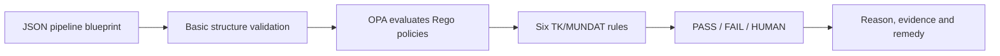

# InspectR

### Design-time compliance inspection for data-pipeline blueprints

InspectR checks whether a planned data pipeline contains the compliance controls
that its organisation expects **before the pipeline is deployed**.

This version is a proof of concept (PoC) for the TK/MUNDAT municipal data-sharing case. InspectR
uses a JSON blueprint, Open Policy Agent (OPA), and Rego policy rules to produce
clear, evidence-based findings.

> **Important:**
> InspectR checks and can verify what the pipeline structure declares. It does **not** prove that a control works at runtime or that the organisation is compliant.

### Core definitions

| Term | Definition |
| --- | --- |
| **Blueprint** | A machine-readable description of a planned data pipeline. |
| **Compliance gate** | A design checkpoint that must be defined before a sensitive activity can be approved for implementation. |
| **Connection** | A link between two nodes showing how data, control or approval moves. |
| **Data source** | A system or dataset from which the pipeline reads data. |
| **Design-time compliance** | Checking a planned architecture before deployment or execution. |
| **Evidence** | A blueprint value or calculated fact used to support a compliance result. |
| **Infrastructure metadata** | Information about storage, hosting, encryption and retention. |
| **Node** | One component or activity in the pipeline graph. |
| **OPA** | Open Policy Agent: the engine that evaluates policy rules against input data. |
| **Policy** | An organisational interpretation of a legal or governance requirement. |
| **Rego** | The policy language used to write rules for OPA. |
| **Runtime compliance** | Checking what happens while a pipeline is operating. |
| **Static inspection** | Analysis of a document or design without running the pipeline. |

## 1. The MUNDAT case

MUNDAT is a Trondheim municipal data-sharing use case. A data consumer requests
data for research, public services or innovation. The municipality must identify
the relevant systems, assess risks, extract and combine data, protect sensitive
information, approve the sharing, and deliver the result securely.

The use case includes:

- receiving and assessing a data request;
- identifying relevant data sources;
- performing DPIA and risk assessments;
- extracting and integrating data;
- anonymising or otherwise protecting sensitive data;
- checking purpose, recipient and contractual conditions;
- sharing the final dataset securely.

### InspectR's specific focus

MUNDAT can be interpreted in many ways. This project focuses specifically on:

> **Automating compliance checks at design time, using metadata in a planned data
> pipeline.**

InspectR does not implement the whole MUNDAT operational process. It demonstrates
how selected compliance expectations can be translated into inspectable blueprint
properties and Rego rules.

### The example blueprint

[`data/tk_mundat_data_sharing_v2.json`](./data/tk_mundat_data_sharing_v2.json)
models this flow:

```text
request
  -> classify_request
  -> dpia_check
  -> extract_data
  -> integrate_dataset
  -> anonymisation
  -> sharing_assessment
  -> share_dataset
```

It includes:

- the **Sickleave** case dataset, assembled from the `health_services` and
  `citizen_registry` source systems;
- personal-data and special-category-data declarations;
- schema fields, PII markers and masking strategies;
- storage, encryption and retention metadata;
- DPIA and risk-assessment properties;
- a metadata catalog reference and an integration node with lineage and
  provenance properties;
- an anonymisation step;
- purpose, contract, recipient and agreement properties;
- transfer encryption and audit-trail properties.

The TK/MUNDAT source description identifies two example datasets: **Sickleave**
and **IoT** stormwater sensor data. This v2 blueprint models the **Sickleave**
scenario only. It does not model the IoT dataset, because the active rules focus
on sensitive personal-data sharing. The names `health_services` and
`citizen_registry` are source-system nodes used to build the Sickleave workflow,
not alternative names for MUNDAT's two example datasets.

## 2. The nature of data pipelines

A data pipeline is a planned route for data:

```text
request -> identify sources -> extract -> integrate -> protect -> approve -> share
```

For example, a municipality may receive a request to combine HR data from
several systems, remove identifying information, and share a research dataset.
The pipeline blueprint describes this planned route before implementation.

### How the TK blueprint is built

The unified blueprint is assembled from three architectural input layers:

1. **Data Schema** — fields, data types, personal-data classification and
   protection metadata.
2. **Pipeline Manifest** — processing stages, destinations, purposes,
   dependencies and declared checkpoints.
3. **Infrastructure / IaC** — storage, hosting, encryption, retention and
   deployment properties.

These inputs are represented together as one JSON blueprint for InspectR.
The three layers are an architectural decomposition for this PoC; they are
not a mandatory universal file format.

The blueprint is a JSON document containing a `pipeline` object. The pipeline
has two main parts:

1. **Nodes** — the activities, systems, data sources and control points.
2. **Connections** — the edges between nodes that describe data, control,
   authorisation or approval flows.

Each node has an `id`, a `type`, and `properties`:

```json
{
  "id": "dpia_check",
  "type": "compliance_gate",
  "properties": {
    "dpia_checkpoint_defined": true,
    "risk_assessment_checkpoint_defined": true
  }
}
```

### What the blueprint can describe

| ELEMENT | What it describes | Example |
| --- | --- | --- |
| **Node** | A step, system, source or control in the pipeline | `extract_data` |
| **Node ID** | The unique name used to refer to a node | `health_services` |
| **Node type** | The role of the node | `data_source`, `data_transfer` |
| **Properties** | Facts and declarations about the node | `contains_personal_data: true` |
| **Data source** | A system or dataset entering the pipeline | HR or citizen registry |
| **Data processing** | An operation performed on data | Extraction or cleaning |
| **Data integration** | Combining or harmonising data from sources | Joining datasets |
| **Privacy control** | A protection step applied to data | Anonymisation |
| **Compliance gate** | A decision or control point before continuing | DPIA or sharing approval |
| **Data transfer** | A planned delivery or export of data | Open-data portal |
| **Infrastructure metadata** | Where and how data is stored | Storage provider, encryption |
| **Schema metadata** | The fields and sensitivity of a dataset | `employee_id` is PII |
| **Connection / edge** | A relationship between two nodes | `from: extract_data` to `integrate_dataset` |
| **Evidence property** | A value that a policy can inspect | `lineage_record_defined: true` |

### Design-time meaning of blueprint values

The blueprint describes a **planned** pipeline. Boolean values are therefore
design declarations:

- `true` means the design includes or requires the named checkpoint or control;
- `false` means the design explicitly does not include it;
- missing or `null` means the design does not provide enough information.

For example, `dpia_checkpoint_defined: true` means that the blueprint includes
a DPIA checkpoint. It does not mean that a DPIA has already been performed or
approved. Runtime implementation and document review happen later.

### Design-time checkpoint statuses

These statuses describe the state of the planned control, not the state of
real-world data or runtime execution:

| Status | Meaning |
| --- | --- |
| `required` | The control is required by the design or policy. |
| `defined` | The blueprint includes the checkpoint or architectural control. |
| `planned` | The control is intended to be implemented before deployment. |
| `verified` | Evidence has been reviewed and accepted by an authorised reviewer. |
| `not_applicable` | The control does not apply to this pipeline design. |
| `unknown` | The blueprint does not contain enough information. |
| `failed` | The design explicitly lacks the required control. |

The current PoC uses Boolean design properties for the active Rego checks. A
value of `true` means that the checkpoint or control is defined in the design;
it does not mean that it has already been completed, approved or technically
verified.

## 3. Metadata Catalogue

The **Metadata Catalogue** is the authoritative reference for the data used by
the pipeline. It keeps the information needed to understand, govern and trace
datasets in one place.

It is needed because a blueprint value such as
`lineage_record_defined: true` only declares that the design identifies a
lineage record. The catalogue
provides the records behind that declaration: sources, owners, schemas,
sensitivity, transformations, outputs and versions.

The blueprint references catalogue records when it is built. InspectR can then
use those references as traceable design-time evidence. The catalogue supports
accountability and the MUNDAT metadata and traceability requirements; it is not
itself a specific GDPR requirement and does not replace legal or runtime checks.

### Metadata Catalogue for the MUNDAT blueprint

| Catalogue record | Example reference | What it contains | Used by |
| --- | --- | --- | --- |
| **Catalogue** | `catalog:trondheim-mundat` | Authority and available metadata domains | All pipeline metadata |
| **Dataset** | `dataset:health-services` | Source identity, owner, schema and sensitivity | Data-source selection and risk checks |
| **Dataset** | `dataset:citizen-registry` | Source identity, owner, schema and sensitivity | Data-source selection and risk checks |
| **Lineage** | `lineage:tk-mundat-sickleave-v2` | Source-to-process-to-output relationships and transformations | TK-004 |
| **Provenance** | `provenance:tk-mundat-sickleave-v2` | Processing activity, versions, timestamps and responsibility | Traceability and audit evidence |

In the blueprint, these references appear on the `metadata_catalog`, data-source
and `integrate_dataset` nodes. The current TK-004 rule checks
`lineage_record_defined`; future policy versions can additionally verify that the
catalogue and lineage references are present and complete.

## 4. InspectR flow



In simple terms:

1. The user uploads a JSON blueprint.
2. InspectR checks that it contains a valid `pipeline` and `pipeline.nodes` list.
3. InspectR sends the blueprint directly to OPA.
4. OPA applies the Rego rules in [`policies/tk/`](./policies/tk/).
5. InspectR validates and displays one result for each rule.

No intermediate representation is used in this proof of concept.


## 5. The six compliance rules

The rules do not read legal documents or inspect the running pipeline. They
inspect the structure and properties declared in the blueprint.

### Rule overview

| Rule ID | Rule name | Core purpose | What it does | What it checks exactly | How it checks / supports compliance |
| --- | --- | --- | --- | --- | --- |
| **TK-001** | DPIA checkpoint | Ensure high-risk personal-data processing has a planned DPIA checkpoint. | Detects whether a data source is marked as containing both personal data and special-category data. | `data_source.contains_personal_data == true`; `data_source.contains_special_category_data == true`; then a `compliance_gate` must have `dpia_checkpoint_defined == true`. | Returns **PASS** when the checkpoint is defined or no trigger is detected; returns **FAIL** when sensitive processing is declared but a gate explicitly sets the checkpoint to `false`. |
| **TK-002** | Special-category risk-assessment checkpoint | Ensure sensitive-data processing includes a planned risk-assessment checkpoint. | Finds data sources marked as containing special-category data and tests the related risk checkpoint. | `data_source.contains_special_category_data == true`; then a `compliance_gate` must have `risk_assessment_checkpoint_defined == true`. | Returns **PASS** when the checkpoint is defined or no special-category source is declared; returns **FAIL** when sensitive data is declared but the checkpoint is explicitly `false`. |
| **TK-003** | Data-sharing agreement checkpoint | Ensure planned personal-data transfers include an agreement checkpoint. | Detects personal data together with a planned `data_transfer` node. | `data_source.contains_personal_data == true`; a `data_transfer` node is present; then a `compliance_gate` must have `data_sharing_agreement_checkpoint_defined == true`. | Returns **PASS** when the agreement checkpoint is defined or no personal-data transfer is detected; returns **FAIL** when the transfer is triggered but the checkpoint is explicitly `false`. |
| **TK-004** | Lineage and provenance record | Ensure integrated datasets have a traceability record identified in the design. | Finds `data_integration` nodes and checks whether each relevant integration design identifies a lineage record. | `node.type == "data_integration"`; `properties.lineage_record_defined == true`. | Returns **PASS** when a lineage record is declared or no integration node exists; returns **FAIL** when an integration node explicitly sets `lineage_record_defined` to `false`. It checks the declaration only, not catalogue completeness. |
| **TK-005** | Purpose compatibility review | Ensure intended purpose compatibility is explicitly considered before sharing. | Tests whether each compliance gate declares purpose compatibility; it escalates uncertainty instead of guessing. | For every `compliance_gate`, `purpose_compatibility_declared` must be exactly `true`. | Returns **PASS** when the declaration is true; returns **HUMAN** when it is missing, `null` or `false`, so legal and organisational context can be reviewed. It does not make the legal determination itself. |
| **TK-006** | Complete sharing safeguards | Ensure the fixed set of sharing safeguards is represented in the planned workflow. | Evaluates one checklist covering the DPIA, risk, agreement, recipient-approval and transfer-encryption controls. | `dpia_check.dpia_checkpoint_defined`; `dpia_check.risk_assessment_checkpoint_defined`; `sharing_assessment.data_sharing_agreement_checkpoint_defined`; `sharing_assessment.recipient_approval_checkpoint_defined`; `share_dataset.encryption_in_transit_configured` must all be exactly `true`. | Returns **PASS** only when all five controls are true; returns **FAIL** when any is missing, `null` or not true. This confirms design declarations, not implementation or runtime operation. |

The rules provide **design-time evidence checks**, not legal certification. A
`PASS` means that the encoded requirement is represented in the blueprint (or
that the rule is not triggered); it does not prove that the control has been
implemented, approved, or operated successfully.

### How to read the rule matrix

Each rule has its own decision logic. **Not every rule can return all three
statuses**:

| Status | Simple meaning |
| --- | --- |
| **PASS** | The required control is declared, or the rule is not triggered. |
| **FAIL** | The rule finds an applicable control that is explicitly false. TK-006 also fails for missing values. |
| **HUMAN** | The rule cannot safely decide from metadata and requires human review. Currently only TK-005 uses this status. |

The matrix for each rule below shows exactly what each possible outcome means.

### TK-001 — DPIA required

**What it checks:** Whether sensitive personal-data processing has a defined
DPIA checkpoint.

**Logic:**

```text
personal data + special-category data
        -> DPIA checkpoint required
        -> dpia_checkpoint_defined must be true
```

| Status | When TK-001 returns it | Simple interpretation |
| --- | --- | --- |
| **PASS** | A source contains personal and special-category data and a compliance gate says `dpia_checkpoint_defined: true`; **or** no source is marked as both. | The design includes a DPIA checkpoint, or this rule sees no DPIA trigger. |
| **FAIL** | A sensitive source exists and a compliance gate explicitly says `dpia_checkpoint_defined: false`. | A DPIA checkpoint is needed but is not defined in the design. |
| **HUMAN** | Not produced by the current TK-001 Rego rule. | Human review is not separately represented for this rule. |

**What PASS proves:** The blueprint declares a DPIA checkpoint. It does not
prove that a DPIA has been completed or assess its content.

### TK-002 — Risk assessment

**What it checks:** Whether special-category data has a defined risk-assessment
checkpoint.

**Logic:**

```text
special-category data present
        -> risk-assessment checkpoint required
        -> risk_assessment_checkpoint_defined must be true
```

| Status | When TK-002 returns it | Simple interpretation |
| --- | --- | --- |
| **PASS** | Special-category data exists and a gate says `risk_assessment_checkpoint_defined: true`; **or** no special-category source exists. | The design includes a risk-assessment checkpoint, or this rule is not triggered. |
| **FAIL** | Special-category data exists and a compliance gate explicitly says `risk_assessment_checkpoint_defined: false`. | Sensitive data is present but the risk-assessment checkpoint is not defined. |
| **HUMAN** | Not produced by the current TK-002 Rego rule. | Human review is not separately represented for this rule. |

**What PASS proves:** The blueprint declares a risk-assessment checkpoint. It
does not prove that the assessment has been performed or review its content.

### TK-003 — Data-sharing agreement

**What it checks:** Whether personal data is transferred under a defined
data-sharing agreement checkpoint.

**Logic:**

```text
personal data + data transfer
        -> agreement checkpoint required
        -> data_sharing_agreement_checkpoint_defined must be true
```

| Status | When TK-003 returns it | Simple interpretation |
| --- | --- | --- |
| **PASS** | Personal data is transferred and a gate says `data_sharing_agreement_checkpoint_defined: true`; **or** no personal-data transfer is detected. | The design includes an agreement checkpoint, or this rule is not triggered. |
| **FAIL** | Personal data is transferred and a compliance gate explicitly says `data_sharing_agreement_checkpoint_defined: false`. | Personal data is planned for transfer but the agreement checkpoint is not defined. |
| **HUMAN** | Not produced by the current TK-003 Rego rule. | Human review is not separately represented for this rule. |

**What PASS proves:** The blueprint declares an agreement checkpoint. It does
not prove that an agreement exists, is signed, or is legally valid.

### TK-004 — Data lineage

**What it checks:** Whether an integration step identifies a lineage record.

**Logic:**

```text
data integration node exists
        -> lineage_record_defined must be true
```

| Status | When TK-004 returns it | Simple interpretation |
| --- | --- | --- |
| **PASS** | An integration node says `lineage_record_defined: true`; **or** no integration node exists. | The design identifies a lineage record, or this rule is not triggered. |
| **FAIL** | An integration node explicitly says `lineage_record_defined: false`. | The integration design does not identify a lineage record. |
| **HUMAN** | Not produced by the current TK-004 Rego rule. | Human review is not separately represented for this rule. |

**What PASS proves:** The blueprint identifies a planned lineage record. It does not
inspect whether the catalog or lineage records are complete or accurate. The
catalog reference makes the evidence traceable, but the current PoC rule still
checks the declared `lineage_record_defined` property only.

### TK-005 — Purpose compatibility

**What it checks:** Whether the design declares that purpose compatibility has
been reviewed.

**Logic:**

```text
purpose_compatibility_declared is missing, null or not true
        -> HUMAN review

purpose_compatibility_declared is true
        -> PASS
```

| Status | When TK-005 returns it | Simple interpretation |
| --- | --- | --- |
| **PASS** | At least one compliance gate says `purpose_compatibility_declared: true` and no gate requires escalation; **or** no compliance gates exist. | The design declares purpose compatibility, or no purpose gate is present. |
| **FAIL** | Not produced by the current TK-005 Rego rule. | This rule escalates uncertainty to HUMAN rather than reporting FAIL. |
| **HUMAN** | Any compliance gate has `purpose_compatibility_declared` missing, null, false or not exactly true. | A person must review the original purpose, new purpose, legal basis and context. |

**Why HUMAN exists:** Purpose compatibility depends on context, legal basis,
original purpose, new purpose and organisational judgement. A Boolean field alone
cannot replace that review.

### TK-006 — Complete sharing safeguards

**What it checks:** Five fixed controls in the sharing workflow:

1. `dpia_check.dpia_checkpoint_defined`
2. `dpia_check.risk_assessment_checkpoint_defined`
3. `sharing_assessment.data_sharing_agreement_checkpoint_defined`
4. `sharing_assessment.recipient_approval_checkpoint_defined`
5. `share_dataset.encryption_in_transit_configured`

**Logic:**

```text
all five design controls are exactly true -> PASS
any control is false or missing           -> FAIL
```

| Status | When TK-006 returns it | Simple interpretation |
| --- | --- | --- |
| **PASS** | All five design controls are exactly `true`. | The blueprint defines every required sharing checkpoint or control. |
| **FAIL** | Any one of the five controls is false, null or missing. | At least one sharing checkpoint or control is not defined. |
| **HUMAN** | Not produced by the current TK-006 Rego rule. | This rule is a fixed Boolean checklist and does not escalate to human review. |

**What PASS proves:** The blueprint defines all five planned safeguards. It does
not prove that the safeguards are implemented or operate in reality.

## 6. Example evaluation

When the example v2 blueprint is evaluated, the current results are:

| Rule | Result | Simple explanation |
| --- | --- | --- |
| TK-001 | **PASS** | Sensitive data is present and DPIA completion is declared. |
| TK-002 | **PASS** | Risk-assessment completion is declared. |
| TK-003 | **PASS** | Personal-data transfer and a sharing agreement are declared. |
| TK-004 | **PASS** | The integration design identifies a lineage record. |
| TK-005 | **HUMAN** | One compliance gate has no purpose-compatibility declaration, so review is required. |
| TK-006 | **PASS** | All five required sharing checkpoints or controls are defined. |

## 7. Running InspectR

### Requirements

- Windows
- Python
- The packages in [`requirements.txt`](./requirements.txt)
- OPA installed at `C:\Tools\OPA\opa.exe`

### Start the application

Run from the repository root:

```powershell
.\.venv\Scripts\Activate.ps1
pip install -r requirements.txt
streamlit run app.py
```

Then open the **Evaluation** page, upload a JSON blueprint, and select
**Run InspectR**.

## 8. Repository structure

| Path | Purpose |
| --- | --- |
| [`app.py`](./app.py) | Streamlit configuration and navigation |
| [`pages/evaluation.py`](./pages/evaluation.py) | Upload, evaluation and result display |
| [`src/evaluator.py`](./src/evaluator.py) | Input validation, OPA execution and result validation |
| [`policies/tk/`](./policies/tk/) | Active TK/MUNDAT Rego policies |
| [`data/`](./data/) | Example blueprints and taxonomy data |
| [`tk-uc/`](./tk-uc/) | TK/MUNDAT source material |


## 8. Limitations

Current PoC implementation deliberately excludes IR.

---

> Disclaimer:
InspectR provides **design-time evidence**, not a complete compliance certificate. 

---

sirin-koca 2026 | UIO 
