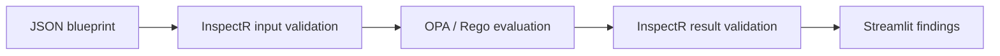

# InspectR

## Compliance-by-design for data pipelines using Policy-as-Code

InspectR is a research prototype for design-time inspection of data-pipeline blueprints. It uses Open Policy Agent (OPA) and Rego to evaluate selected
metadata conditions and present findings with reasons, supporting evidence, and remediation guidance.

A pipeline structure (blueprint) describes how data moves through operations, with dependencies, conditions, and configuration. My research question is: _What information must a pipeline design expose to make a selected requirement machine-checkable?_

> **Status:** Early-stage proof of concept (PoC), October 2026. The current
> implementation establishes an initial baseline, not the final scope of
> InspectR. A broader, standalone architecture incorporating an intermediate
> representation (IR) is planned.

> Assurance boundary: InspectR checks supplied design information against
> encoded policy interpretations. It does not establish legal compliance,
> completed approvals, or the implementation and runtime effectiveness of
> controls.

## Contents

- [Research context](#research-context)
- [Current PoC](#current-poc)
- [Architecture](#architecture)
- [Pipeline blueprint](#pipeline-blueprint)
- [Metadata catalogue and evidence](#metadata-catalogue-and-evidence)
- [Policy checks](#policy-checks)
- [Interpreting findings](#interpreting-findings)
- [Planned architecture and research directions](#planned-architecture-and-research-directions)
- [Evaluation status](#evaluation-status)
- [Limitations](#limitations)
- [Running the prototype](#running-the-prototype)
- [Repository structure](#repository-structure)
- [Terminology](#terminology)

## Research context

InspectR is being developed as an MSc thesis artefact in Systems Architecture
at the University of Oslo, in collaboration with SINTEF within DataPACT.

The thesis follows Design Science Research (DSR). Its broader motivation is
compliance automation for data and AI systems, with an emphasis on
compliance-by-design: identifying relevant design issues before deployment.

The research investigates how selected compliance expectations can be
translated into inspectable architectural information and executable
Policy-as-Code checks. Development and planned case evaluation are grounded
in MUNDAT, the Trondheim Kommune municipal data-sharing use case.

The application, initial policy interpretations, and blueprint enrichment
were developed by the thesis author. The interpretations have not yet been
validated by SINTEF, Trondheim Kommune, or legal reviewers.

Planned submission: May 2027. The final contribution and evaluation scope remain under development.

## Current PoC

The current application supports:

- Uploading a JSON pipeline blueprint and preview.
- JSON parsing and basic input-structure validation.
- Evaluation of three Rego rules (rule set `tk-v2.0`) through OPA.
- Validation of returned result fields and status values.
- Side-by-side presentation of the blueprint metadata and findings.
- Display of policy-provided reasons, evidence, references, and remedies.

The PoC inspects declared node properties. It does not execute pipelines,
inspect actual datasets, enforce runtime decisions, or analyse graph paths.

The current input format is JSON. Native inspection of other pipeline
formats or Infrastructure-as-Code (IaC) files is not implemented.
Infrastructure-related metadata is represented within the example blueprint.

## Architecture

### Current evaluation flow (without IR)



| Component | Responsibility |
|---|---|
| Streamlit GUI | Upload, interaction, session state, and presentation. |
| InspectR Python evaluator | Structural checks, OPA invocation, response parsing,  result validation. |
| OPA | Execution of Rego policies against the supplied input. |
| Rego policies | Conditions, decision branches, and finding construction. |

InspectR coordinates the inspection workflow; OPA performs policy evaluation.
The current PoC passes the blueprint directly to OPA without an IR.

### Evaluator

`src/evaluator.py` checks that the input is a JSON object with a `pipeline`
object, a `pipeline.nodes` list, and a string `id` on every node. An
unreadable blueprint raises an input error and no rule is evaluated.

The evaluator then reads the rule manifest and queries each rule separately:

```text
Policy directory: policies/tk
Manifest:         data.inspectr.manifest
Per rule:         data.inspectr.tk.r1.result, ...r2.result, ...r3.result
```

`policy.rego` also exposes `data.inspectr.results` (all three results) for
direct use with `opa eval`.

The evaluator requires each returned result to contain:

```text
rule
status
legal_reference
reason
evidence
remedy
```

It validates field presence and permitted status values, not legal accuracy,
evidence correctness, or policy completeness. If a single rule fails (OPA
error, undefined or conflicting result, malformed result), that rule returns
`ERROR` and the other results are kept.


## Pipeline blueprint

A blueprint is a machine-readable description of a planned pipeline.

### What can a data-pipeline blueprint describe?

A pipeline blueprint can represent planned activities, data relationships,
configuration, and governance declarations. The information available depends
on the modelling language, designer, and metadata supplied.

The categories below are an organisational overview, not a universal standard
or a list of capabilities currently implemented in InspectR.

| Category | Element | What it describes | Example |
|---|---|---|---|
| Representation structure | Node | A represented activity, system, dataset, control, or destination. | Extraction activity |
| Representation structure | Identifier | An identifier for referencing an element within a defined scope. | `extract_data` |
| Representation structure | Type | The declared category of an element. | `data_source`, `data_transfer` |
| Representation structure | Property | A declared attribute, configuration value, or reference. | `contains_personal_data: true` |
| Representation structure | Connection / edge | A typed relationship between elements, with explicitly defined meaning. | Data flow or execution dependency |
| Data description | Sources and outputs | Systems or datasets consumed or produced by an operation. | HR dataset → aggregated research dataset |
| Data description | Schema | Field names, types, and structural constraints. | `employee_id: string` |
| Data description | Classification | Declared sensitivity or governance classifications of datasets or fields. | Personal data; special-category data |
| Processing and flow | Processing activity | A planned operation and, where specified, its inputs and outputs. | Extraction, filtering, or cleaning |
| Processing and flow | Integration | A planned combination or harmonisation of data. | Joining datasets |
| Processing and flow | Dependencies and conditions | Declared ordering, branching, and conditions for proceeding. | Release depends on approval |
| Processing and flow | Transfer and destination | A planned delivery or publication and its intended endpoint. | Publish an output to an open-data portal |
| Infrastructure and configuration | Deployment and storage | Declared hosting, storage, and deployment characteristics. | Storage service and deployment region |
| Infrastructure and configuration | Security settings | Planned technical protection settings. | Encryption at rest and in transit |
| Infrastructure and configuration | Retention settings | Declared retention periods and deletion configuration. | Retain for 30 days; purge configured |
| Governance and safeguards | Purpose and usage restrictions | Intended processing purposes and declared limits on use. | Research purpose; no onward sharing |
| Governance and safeguards | Roles and access | Declared responsibilities, permissions, and recipient conditions. | Dataset owner; authorised recipient role |
| Governance and safeguards | Privacy measures | Planned operations intended to protect data. | Aggregation, masking, or anonymisation |
| Governance and safeguards | Assessment and approval checkpoints | Planned review or authorisation points and their dependencies. | Risk review before release |
| Traceability and supporting references | Planned lineage | Declared relationships between sources, transformations, and outputs. | Output derived from two specified sources |
| Traceability and supporting references | Supporting-artifact references | Identifiers or versions of relevant catalogue records, specifications, policies, or review records. | Lineage-record ID; policy version |


### Example and provenance

```text
data/tk_mundat_data_sharing_v2.json
```

The initial blueprint was created using inLUMEN. V2 was manually enriched
by the thesis author because the initial export lacked metadata required
by the proposed checks.

The intended longer-term workflow is for pipeline representations to
originate from designers or other supported tools. Manual enrichment is
part of the current experiment, not an established production integration.

### MUNDAT scenario

DataPACT Deliverable D5.1, Section 3.7, identifies:

| Dataset | Description |
|---|---|
| Sickleave | Research dataset combining sick-leave registration, work-environment surveys, turnover reports, and HR demographic data. |
| IoT | Stormwater-basin sensor data measuring sand levels. |

V2 models a Sickleave-related scenario and explicitly excludes IoT.

Source identifiers such as `health_services` and `citizen_registry`,
together with their schemas and configuration values, are illustrative
modelling assumptions. They are not confirmed municipal system details
or a validated reproduction of the documented contributing sources.

### Structure and metadata

The example contains nodes and typed connections.

| Element | Meaning |
|---|---|
| Node | A source, activity, checkpoint, control, or destination. |
| Node ID | Identifier used to reference a particular node. |
| Node type | Category used by policies to select relevant nodes. |
| Properties | Metadata and design declarations inspected by policies. |
| Connection | A declared data, control, authorisation, approval, or metadata relationship. |

The blueprint combines:

- **Schema metadata**: fields, types, PII markers, and masking strategies.
- **Pipeline metadata**: processing steps, purposes, and checkpoints.
- **Infrastructure metadata**: storage, encryption, retention, and purge settings.
- **References**: catalogue, dataset, lineage, and provenance identifiers.

These categories are represented in one JSON document. They are not
automatically extracted from separate schema, manifest, and IaC files.

Not all properties are evaluated by the current policies.

### Design declarations

```json
{
  "id": "dpia_check",
  "type": "compliance_gate",
  "properties": {
    "dpia_checkpoint_defined": true,
    "risk_assessment_checkpoint_defined": true
  }
}
```

Here, `true` declares that a checkpoint is included in the design. It does
not establish that an assessment has been performed or approved.

For the relevant Boolean properties, `false` declares absence; missing or
`null` values provide no affirmative declaration. Actual outcome handling
depends on the rule.

## Metadata catalogue and evidence

### Catalogue representation

The example includes a `metadata_catalog` node describing an intended
reference point for dataset identity, ownership, schemas, sensitivity,
processing activities, lineage, and provenance.

| Example reference | Intended role |
|---|---|
| `catalog:trondheim-mundat` | Modelled catalogue identity. |
| `dataset:health-services` | Record for an illustrative source. |
| `dataset:citizen-registry` | Record for an illustrative source. |
| `lineage:tk-mundat-sickleave-v2` | Intended lineage-record reference. |
| `provenance:tk-mundat-sickleave-v2` | Intended provenance-record reference. |

### Finding evidence

| Field | Contents |
|---|---|
| `input_evidence` | Selected observations, descriptive selectors, expected values, and conditions. |
| `derived_evidence` | Facts or labels calculated or assigned by the policy. |

The evidence explains the encoded decision. 
Selectors are descriptive strings, not guaranteed executable JSONPath
expressions. The observed value `"<absent>"` means the field is not in the
blueprint. No legacy fallback fields are accepted.

## Policy checks

The current rules are preliminary author-developed interpretations.
Their legal references are not validated mappings to legal obligations.

Rule set `tk-v2.0`. Each rule has the form IF trigger THEN control.

| Rule | Replaces | Trigger | Control | Statuses |
|---|---|---|---|---|
| TK-R1 | TK-001, TK-002 | A source declares special-category data. | One compliance gate declares DPIA and risk-assessment checkpoints. | PASS, FAIL, UNKNOWN, NOT_APPLICABLE |
| TK-R2 | TK-004 | An integration node exists. | Every integration node declares a lineage record. | PASS, FAIL, UNKNOWN, NOT_APPLICABLE |
| TK-R3 | TK-005 | A transfer node exists and a source declares personal data. | Gates carrying the field declare purpose compatibility. | HUMAN, FAIL, UNKNOWN, NOT_APPLICABLE |

TK-003 and TK-006 were dropped. The reasons and the full list of fixes are in
`docs/RULESET-V2-CHANGES.md`. The decision table of each rule is in the header
comment of its Rego file.

**FYI**: These are thesis authors' policy interpretations derived from TK documents. They are preliminary design-time checks inspired by selected MUNDAT requirements. 

## Policy traceability record
For each rule, it is necessary to document: TK source → compliance expectation → organisational / implementation interpretation → encoded check → unverified assumptions → reviewer/status

Tasks: Create one record for each policy rule. Distinguish source requirements, proposed interpretations, and implemented behaviour.

| Field | What to document |
|---|---|
| Rule ID and title | Unique identifier and short description. |
| TK source | Exact section, requirement/user-story ID, page, and relevant wording. |
| Compliance expectation | What the source asks for, without adding assumptions. |
| Proposed organisational interpretation | Meaning in the MUNDAT workflow; identify author-proposed interpretations explicitly. |
| Implementation interpretation | Required metadata, applicability conditions, and intended outcomes. |
| Encoded check | Rego file/rule, inspected fields, conditions, fallback fields, and actual decision branches. |
| Evidence and limitations | Where observations come from and what they do—and do not—establish. |
| Unverified assumptions | Interpretations or design decisions requiring confirmation. |
| Reviewer / status | Reviewer, scope of review, date, outcome, and unresolved issues. Use “Not reviewed” where applicable. |

### Example: TK-R2 — Lineage record for integrated data

| Field | Record |
|---|---|
| Rule ID and title | TK-R2 — Lineage record for integrated data (replaces TK-004). |
| TK source | D5.1 §3.7: TK.US.07, p. 59; TK.FR.05, p. 60. |
| Compliance expectation | Support lineage and traceability of data and processing operations. |
| Proposed organisational interpretation | Integration designs should identify a supporting lineage record. Author-proposed; not reviewed. |
| Implementation interpretation | Represent the lineage-record declaration as a Boolean property on integration nodes. |
| Encoded check | `TK-R2.rego` selects nodes of type `data_integration` and reads `properties.lineage_record_defined`. No integration node: NOT_APPLICABLE. Any node with `false`: FAIL. Any node with the field absent, null, or not a boolean: UNKNOWN. All nodes `true`: PASS. No fallback fields. |
| Evidence and limitations | The supplied declaration supports the finding. The referenced lineage record is not retrieved or validated. |
| Unverified assumptions | A Boolean declaration is useful for design review; integration nodes provide an appropriate inspection scope. |
| Reviewer / status | Not reviewed.

## Interpreting findings

Each fact a rule reads is true, false, or undetermined (absent, null, or not
a boolean).

| Status | Meaning |
|---|---|
| `PASS` | The obligation applies and every required control is declared `true`. |
| `FAIL` | The obligation applies and a required control is declared `false`. |
| `UNKNOWN` | A fact the rule needs is undetermined. |
| `HUMAN` | Everything checkable is declared; the final decision is a legal judgement (TK-R3 only). |
| `NOT_APPLICABLE` | The trigger facts are declared `false`; the obligation does not apply. |
| `ERROR` | InspectR could not evaluate the rule. Not a finding about the blueprint. |

A `PASS` is not a compliance certificate; it means the design declares the
control. An undetermined fact never produces `PASS`.

`HUMAN` does not represent a completed review or an implemented approval
workflow. Remedies are policy-authored guidance, not verified legal advice.

## Planned architecture and research directions

### Planned IR-based architecture

The intended final implementation is broader than the current PoC.
It is planned to introduce an intermediate representation to separate
input-specific formats from inspection logic.


The objective is a standalone tool with a common inspection model rather
than an application tied to one designer export.

An IR alone does not guarantee interoperability. Supported adapters,
metadata mappings, semantics, and policy portability must be implemented
and evaluated. The exact supported formats remain to be defined.

### Candidate research directions

| Direction | Possible contribution |
|---|---|
| Requirement operationalisation | Traceable translation from selected requirements to metadata and executable constraints. |
| IR and interoperability | A defined representation and mappings supporting consistent inspection across supported inputs. |
| Architectural control coverage | Inspection of control placement, relevant paths, and bypasses. |
| Incomplete information | Explicit handling of applicability, missing evidence, and indeterminate assessments. |
| Evidence and explanations | Findings linked to observed facts, supporting references, and clearly bounded conclusions. |

These are research candidates, not implemented capabilities or established
novel contributions. Their novelty and value require comparison with
related research and empirical evaluation.

## Evaluation status

The example blueprint currently supports initial functional testing.
A systematic test corpus and completed case evaluation are not yet
documented.

Planned work includes:

- Reviewing case-model fidelity and policy interpretations.
- Documenting requirement-to-policy traceability.
- Establishing independently reviewed expected outcomes.
- Testing valid, invalid, incomplete, and conflicting inputs.
- Evaluating the selected approach against a defined baseline.
- Assessing finding interpretation and practical review effort.
- Evaluating IR mappings and consistency across supported inputs.

The scope will be refined with the supervisors and relevant case stakeholders.

## Limitations

The current PoC:

- Depends on supplied metadata and unvalidated policy interpretations.
- Performs basic structural validation, not complete semantic validation.
- Does not inspect graph paths or enforce checkpoint ordering.
- Does not resolve catalogue or supporting-artifact references.
- Does not verify assessments, agreements, anonymisation, or runtime controls.
- Reads node `type`; a raw inLUMEN export uses `kind`, so TK-R2 and TK-R3
  return NOT_APPLICABLE on it until an adapter maps the export.
- Covers three TK requirements; TK-003 (data-sharing agreement) is not encoded.
- Does not yet implement the planned IR or native multi-format support.

These limitations describe the baseline implementation; they are not
claims that corrective work has already been completed.

## Running the prototype

### Prerequisites

- Python and the dependencies in `requirements.txt`.
- OPA supporting `import rego.v1`.
- Project pages and assets in their expected repository locations.

The evaluator looks for OPA in this order: the `OPA_PATH` environment
variable, `opa` on `PATH`, then `C:\Tools\OPA\opa.exe`.

### Start the application

From the repository root, with a virtual environment available at `.venv`:

```powershell
.\.venv\Scripts\Activate.ps1
pip install -r requirements.txt
streamlit run app.py
```

Open the Evaluation page, upload the example JSON blueprint, and select
Run InspectR.

### Direct policy evaluation

```powershell
Get-Content -Raw data\tk_mundat_data_sharing_v2.json |
  opa eval --format=json `
    --data policies\tk `
    --stdin-input data.inspectr.results
```

Run commands from the repository root because policy and asset paths
are relative.

### Tests

```powershell
opa test policies\tk -v      # one test per decision-table row
pytest tests -v              # evaluator, ERROR isolation, catalogue consistency
```

## Repository structure

```text
app.py                 Streamlit configuration and navigation
pages/                 Application and research-documentation pages
  evaluation.py        Upload, evaluator invocation, and findings
src/
  evaluator.py         Input checks, per-rule OPA execution, ERROR handling
  catalog.py           Rule and status descriptions shown by the app pages
policies/tk/
  policy.rego          Rule manifest and combined results
  lib.rego             Shared helpers (true / false / undetermined facts)
  TK-R*.rego           Rules as decision tables
  tests/               Rego unit tests, one per decision-table row
tests/                 Evaluator and consistency tests (pytest)
docs/                  Change records
data/                  Example blueprints and supporting data
tk-uc/                 MUNDAT source material
images/                Application images and logos
requirements.txt       Python dependencies
```

## Terminology

Definitions below describe usage within this project.

| Term | Meaning |
|---|---|
| Compliance-by-design | Considering compliance expectations during design. |
| Requirement | An expectation the design should address. |
| Policy interpretation | A scoped interpretation translated into inspection logic. |
| Constraint | A precise condition evaluated over a representation. |
| Policy-as-Code | Executable representation of policy conditions; currently Rego. |
| Blueprint | Machine-readable description of a planned pipeline. |
| Intermediate representation | Planned common model separating input formats from inspection logic. |
| Dataset | A collection of data, such as Sickleave. |
| Data source | A system or dataset acting as input to an operation. |
| Trigger | The fact that makes a rule's obligation apply. |
| Obligation | What the requirement demands once triggered. |
| Control | A safeguard in the design intended to meet an obligation. |
| Undetermined | A fact the blueprint provides no usable evidence for (absent, null, or not a boolean). |
| Checkpoint / gate | A planned assessment or approval point; declaration does not establish enforcement. |
| Evidence | Input observations or derived facts supporting an assessment. |
| Metadata catalogue | Reference structure for descriptive and governance records. |
| Lineage | Relationships describing data origins and transformations. |
| Provenance | Information about origin and processing history. |
| Finding | A policy result and its explanatory fields. |
| OPA | Policy-evaluation engine used by InspectR. |
| Evaluator | Python integration coordinating OPA execution and result processing. |
| Infrastructure-as-Code | Infrastructure configuration expressed as code; not natively inspected by the PoC. |

---

MSc thesis research prototype · University of Oslo · Collaboration with SINTEF  
Case context: DataPACT MUNDAT, Trondheim Kommune  
Planned thesis submission: May 2027

---

sirin-koca 2026
