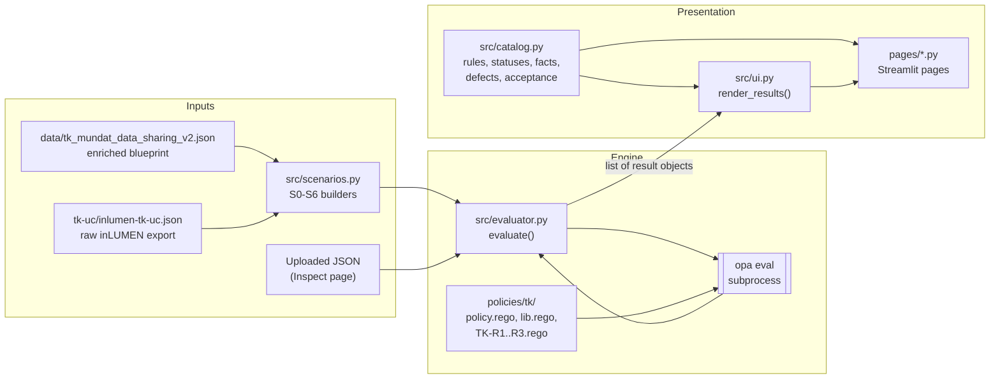
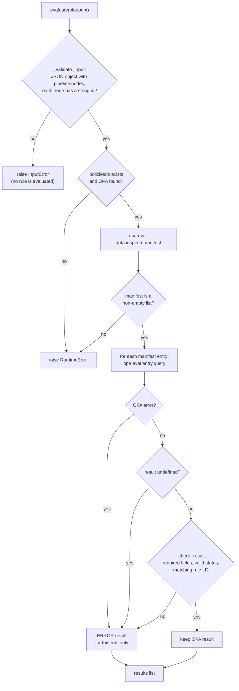
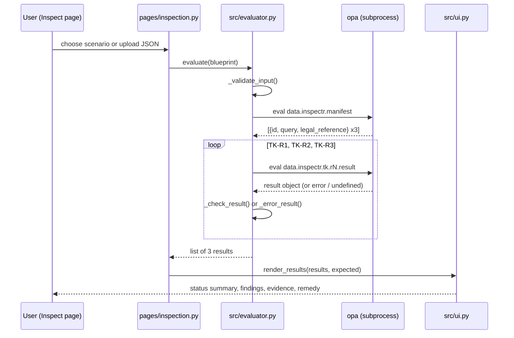
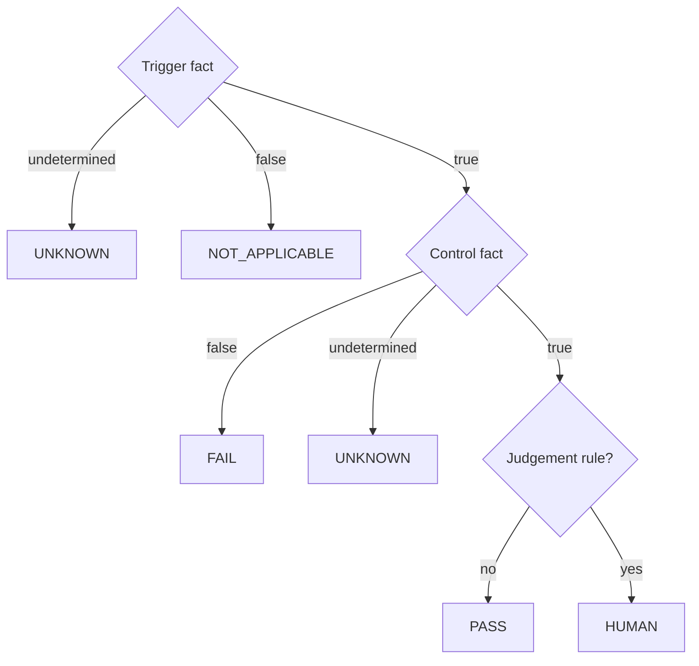

# 2 · Architecture

[← Getting started](01-getting-started.md) · [Wiki home](README.md) · Next: [Policy engine →](03-policy-engine.md)

InspectR separates three concerns: **policy** (Rego rules in `policies/tk/`), **evidence** (a JSON pipeline blueprint), and **orchestration and presentation** (Python and Streamlit). Python never decides a compliance status itself. It validates input, asks OPA for each rule's result, checks the shape of that result, and displays it.

## Component map



| Step | Component | File |
|---|---|---|
| Blueprint input | Enriched blueprint, raw export, scenario variants or an upload | `data/`, `tk-uc/`, `src/scenarios.py`, `pages/inspection.py` |
| Input validation | Rejects blueprints that cannot be read at all (`InputError`) | `src/evaluator.py` (`_validate_input`) |
| Rule discovery | Reads the rule manifest from OPA | `policies/tk/policy.rego` (`data.inspectr.manifest`) |
| Rule evaluation | One `opa eval` per rule, each in its own process | `src/evaluator.py` (`_opa_eval`), `policies/tk/TK-R*.rego` |
| Fact access | Common handling of absent / `null` / wrong-type facts | `policies/tk/lib.rego` |
| Result validation | Checks the result contract; malformed results become `ERROR` | `src/evaluator.py` (`_check_result`) |
| Descriptions | Rule titles, statuses, icons, facts, defects, acceptance criteria | `src/catalog.py` |
| Presentation | Status summary, expandable findings, evidence tables, remedy | `src/ui.py`, `pages/` |

## Evaluation flow

`evaluate(blueprint)` in `src/evaluator.py` implements the flow below. Its docstring summarises it as: *blueprint JSON → input validation → OPA (one query per rule) → result validation → one result per rule.*



Key properties of this design:

- **Fault isolation.** Each rule is a separate OPA query. If one rule errors, is undefined, or returns a malformed object, only that rule becomes `ERROR`; the other results are kept. This fixes v1 defect D1, where one missing field made the whole result list undefined (see [Rego policies → defects](04-rego-policies.md#defects-d1d5)). The test `test_broken_rule_is_error_for_that_rule_only` injects a broken TK-R2 and checks that TK-R1 and TK-R3 still return.
- **Two kinds of failure.** An unreadable blueprint raises `InputError` (a `ValueError`) and gets no status at all. A missing OPA binary, missing policy directory or broken manifest raises `RuntimeError`. Both are shown as an error on the page, not as findings.
- **Policy decides, Python checks.** The status comes from Rego. Python only checks that it is one of the six statuses in `src.catalog.STATUSES`.
- **No intermediate representation.** The PoC passes the blueprint straight to OPA. An IR with adapters for native tool exports is planned under RQ2 (`PoC.md`, "Agreed Boundary").

### Sequence for one inspection



## Result contract

Every result carries at least the fields in `REQUIRED_FIELDS` in `src/evaluator.py`:

| Field | Content |
|---|---|
| `rule` | Rule ID, must match the manifest entry (e.g. `TK-R1`). |
| `status` | One of `PASS`, `FAIL`, `UNKNOWN`, `HUMAN`, `NOT_APPLICABLE`, `ERROR`. |
| `legal_reference` | E.g. `GDPR Art. 35(1), Art. 35(3)(b), Art. 9`. |
| `reason` | Human-readable explanation of the verdict. |
| `evidence` | `input_evidence` (list of `{selector, observed, expected, condition}`) and `derived_evidence` (what Rego concluded). |
| `remedy` | What to change, or `null` when nothing is needed. |

The Rego rules also add `title` and `decision_row`, which links the verdict to a row of the rule's decision table. Example (TK-R1 on the V2 blueprint, abbreviated):

```json
{
  "rule": "TK-R1",
  "title": "DPIA and risk-assessment checkpoint for special-category data",
  "status": "PASS",
  "decision_row": 5,
  "legal_reference": "GDPR Art. 35(1), Art. 35(3)(b), Art. 9",
  "reason": "Special-category data is processed and gate 'dpia_check' declares both a DPIA and a risk-assessment checkpoint.",
  "evidence": {
    "input_evidence": [
      {
        "selector": "pipeline.nodes[id==\"health_services\"].properties.contains_special_category_data",
        "observed": true,
        "expected": "boolean",
        "condition": "Declares whether this source processes special-category data (GDPR Art. 9)."
      }
    ],
    "derived_evidence": {
      "special_category_trigger": "true",
      "compliance_gates": ["dpia_check", "sharing_assessment"],
      "gates_with_both_controls": ["dpia_check"]
    }
  },
  "remedy": null
}
```

## Decision logic shared by all rules

Every rule has the same shape (root `README.md`, Method page):

| Trigger | Control | Status |
|---|---|---|
| undetermined | any | `UNKNOWN` |
| false | any | `NOT_APPLICABLE` |
| true | false | `FAIL` |
| true | undetermined | `UNKNOWN` |
| true | true | `PASS` (`HUMAN` for judgement rules) |

`ERROR` sits outside the table: InspectR failed, not the blueprint. An undetermined fact never produces `PASS` (fail-closed).



## Design decisions

From the "Design decisions and justification" table on the Method page (`pages/method.py`):

| Decision | Justification |
|---|---|
| Rule = IF trigger THEN control | Legal obligations are conditional. |
| Three fact values | Forcing an undetermined fact into true or false invents information. |
| Undetermined → `UNKNOWN`, never `PASS` | A false PASS hides a risk (fail-closed). |
| `NOT_APPLICABLE` as own status | "Does not apply" differs from "satisfied". |
| `HUMAN` as own status | Some requirements are legal judgements. |
| `ERROR` separate from verdicts | A tool failure says nothing about the blueprint. |
| Evidence in every result | A verdict without evidence cannot be audited. |
| Each rule evaluated in isolation | One fault must not suppress other results. |
| Each rule a complete decision table | Every input reaches exactly one status; one test per row. |

## Boundaries

- InspectR reads declared properties only. It does not follow graph paths or checkpoint ordering (for example, whether the DPIA gate is *upstream* of the sensitive source), resolve catalogue references, or verify runtime behaviour.
- `connections` in the blueprint are not read by any rule today; the Case page uses them only to draw the pipeline diagram.
- The raw inLUMEN export is read literally (`kind` instead of `type`); an adapter is planned (RQ2, acceptance criterion AC1).
