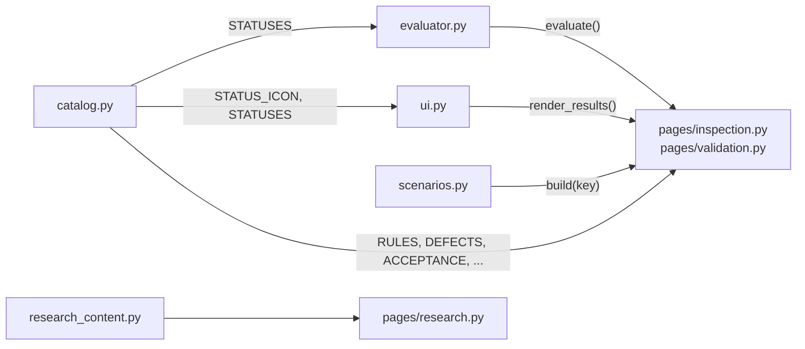
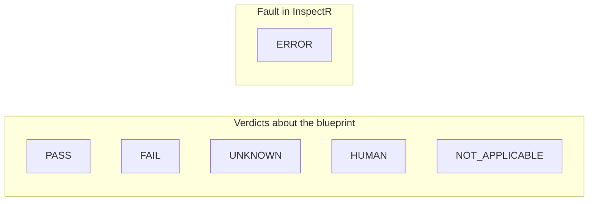

# 3 · Policy engine (`src/`)

[← Architecture](02-architecture.md) · [Wiki home](README.md) · Next: [Rego policies →](04-rego-policies.md)

The `src/` package holds the Python side of InspectR. It contains no compliance decisions; those live in Rego (see [Rego policies](04-rego-policies.md)).

| Module | Role |
|---|---|
| [`src/evaluator.py`](../../src/evaluator.py) | Python/OPA boundary: input validation, OPA discovery, per-rule evaluation, result validation, `ERROR` isolation. |
| [`src/catalog.py`](../../src/catalog.py) | Single source of truth for the rule set, status model, rule facts, defects, acceptance criteria and open questions shown in the app. |
| [`src/scenarios.py`](../../src/scenarios.py) | Built-in scenarios S0–S6 with expected statuses. |
| [`src/ui.py`](../../src/ui.py) | Shared Streamlit helpers for headers, badges, tables, evidence and results. |
| [`src/research_content.py`](../../src/research_content.py) | Content for the Research page (key works, gaps, questions, contributions). |



## Evaluator and OPA integration (`src/evaluator.py`)

### Constants

| Name | Value | Purpose |
|---|---|---|
| `POLICY_PATH` | `Path("policies/tk")` | Directory passed to `opa eval --data`. Relative to the working directory. |
| `MANIFEST_QUERY` | `"data.inspectr.manifest"` | Query that lists the rules to run. |
| `REQUIRED_FIELDS` | `rule`, `status`, `legal_reference`, `reason`, `evidence`, `remedy` | The result contract every rule must meet. |

### Functions

| Function | Behaviour |
|---|---|
| `InputError(ValueError)` | Raised when the blueprint as a whole cannot be read. No rule is evaluated. |
| `_opa_executable()` | Returns the first existing path among `OPA_PATH`, `shutil.which("opa")`, `C:\Tools\OPA\opa.exe`. Raises `FileNotFoundError` otherwise. |
| `_validate_input(blueprint)` | Requires a JSON object with a `pipeline` object, a `pipeline.nodes` list, and a string `id` on every node. Raises `InputError` with a specific message otherwise. |
| `_opa_eval(opa, query, blueprint)` | Runs `opa eval --format=json --data policies/tk --stdin-input <query>` with the blueprint on stdin and a 30 s timeout. Returns `(value, None)`, `(None, None)` when undefined, or `(None, error_message)`. |
| `_error_result(rule_id, legal_reference, message)` | Builds an `ERROR` result: "InspectR could not evaluate this rule: … This is a technical fault in InspectR, not a finding about the blueprint." Remedy: "Report to the InspectR developer." |
| `_check_result(value, rule_id)` | Returns an error message if the value is not a dict, misses a required field, has a status outside `STATUSES`, or reports a different rule ID. |
| `evaluate(blueprint)` | Public entry point. Validates input, checks `POLICY_PATH` and OPA (`RuntimeError` if missing), loads the manifest (`RuntimeError` if undefined or empty), then evaluates each manifest entry and returns one result per rule. |

`evaluate()` error handling at a glance:

| Situation | Outcome |
|---|---|
| Blueprint not an object / no `pipeline.nodes` / node without string `id` | `InputError` raised |
| Policy directory missing, OPA not found, manifest empty or undefined | `RuntimeError` raised |
| OPA returns non-zero exit, invalid JSON, or an unexpected structure for one rule | `ERROR` result for that rule |
| A rule's query is undefined | `ERROR` result ("the rule produced no result (undefined).") |
| A rule's result breaks the contract | `ERROR` result with the specific problem |
| Otherwise | The rule's own result object |

### Calling it directly

```python
import json
from src.evaluator import evaluate

blueprint = json.load(open("data/tk_mundat_data_sharing_v2.json", encoding="utf-8"))
for r in evaluate(blueprint):
    print(r["rule"], r["status"], r.get("decision_row"))
# TK-R1 PASS 5
# TK-R2 PASS 5
# TK-R3 HUMAN 5
```

Run from the repository root with OPA available (see [Getting started](01-getting-started.md#2-make-opa-available-opa_path)).

## Rule catalogue and status model (`src/catalog.py`)

The module docstring explains its purpose: pages read from here instead of keeping their own copies, *"so the UI cannot drift from the Rego rules again. The Rego files in policies/tk remain the authority on behaviour; this file only describes them."* Two tests guard the link between catalogue and Rego (see [Testing](07-testing-and-tooling.md#python-integration-tests)).

| Name | Content |
|---|---|
| `RULE_SET_VERSION` | `"tk-v2.0"` |
| `STATUS_MODEL` | List of `(status, icon, meaning, who acts next)` tuples, one per status. |
| `STATUSES` | Tuple of the six status names, used by the evaluator to validate results. |
| `STATUS_ICON` | Status → icon mapping, used by `src/ui.py`. |
| `RULES` | One dict per rule: `id`, `title`, `replaces`, `tk_requirement`, `legal_reference`, `evidence_class`, `trigger`, `control`, `selectors`, `outcomes`, `boundary`. |
| `DROPPED_RULES` | TK-003 (data-sharing agreement) and TK-006 (complete sharing safeguards), with reasons. |
| `RULE_FACTS` | Each fact a rule reads, its role (trigger/control) and provenance. |
| `DEFECTS` | D1–D5: defect, observed effect, fix. |
| `ACCEPTANCE` | AC1–AC7 from the Scope and Evaluation Proposal (30 Oct 2026), with status and note. |
| `OPEN_QUESTIONS` | Questions for SINTEF shown on the Validation page. |

### Status model

| Status | Icon | Meaning | Who acts next |
|---|---|---|---|
| `PASS` | 🟢 | The obligation applies and the blueprint declares every required control as true. | Nobody (design level only) |
| `FAIL` | 🔴 | The obligation applies and the blueprint declares a required control as false. | Designer: add the control |
| `UNKNOWN` | 🟡 | A fact the rule needs is undetermined: absent, null, or not a boolean. | Designer or inLUMEN: supply the fact |
| `HUMAN` | 🟠 | Everything checkable is declared, but the final decision is a legal judgement. | Legal or domain expert |
| `NOT_APPLICABLE` | ⚪ | The trigger facts are declared false, so the obligation does not apply. | Nobody |
| `ERROR` | ⛔ | InspectR could not evaluate the rule. Not a finding about the blueprint. | InspectR developer |

`PASS` is not a compliance certificate. It means the design declares the control.



### Rules in the catalogue

| Rule | Replaces | Evidence class | Possible outcomes | Boundary |
|---|---|---|---|---|
| TK-R1 · DPIA and risk-assessment checkpoint | TK-001, TK-002 | Declared | PASS, FAIL, UNKNOWN, NOT_APPLICABLE | Does not assess whether a DPIA was carried out, its quality, or its legal adequacy. |
| TK-R2 · Lineage record for integrated data | TK-004 | Derivable (from inLUMEN runs, future) | PASS, FAIL, UNKNOWN, NOT_APPLICABLE | Does not verify lineage quality, completeness, or runtime generation. |
| TK-R3 · Purpose compatibility before sharing | TK-005 | Judgement | HUMAN, FAIL, UNKNOWN, NOT_APPLICABLE | Does not perform the legal compatibility assessment itself. |

### Fact provenance (`RULE_FACTS`)

Provenance codes: **S** = structural (from the pipeline graph), **D** = derivable from tooling, **M** = manual declaration, **H** = human judgement.

| Rule | Fact | Role | Provenance |
|---|---|---|---|
| TK-R1 | `data_source.contains_special_category_data` | Trigger | M (future: D from schema/PII detection) |
| TK-R1 | `compliance_gate.dpia_checkpoint_defined` | Control | M |
| TK-R1 | `compliance_gate.risk_assessment_checkpoint_defined` | Control | M |
| TK-R2 | node type `data_integration` | Trigger | S |
| TK-R2 | `data_integration.lineage_record_defined` | Control | M (future: D from inLUMEN runs) |
| TK-R3 | node type `data_transfer` | Trigger | S |
| TK-R3 | `data_source.contains_personal_data` | Trigger | M (future: D from schema/PII detection) |
| TK-R3 | `compliance_gate.purpose_compatibility_declared` | Control | H (declared, confirmed by an expert) |

## Scenario builder (`src/scenarios.py`)

Each scenario is the enriched V2 blueprint with one controlled change, or the raw inLUMEN export. Together they exercise every non-`ERROR` status, and the expected results turn the demonstration into a live regression check (used by the Inspect page, the Validation page and `test_demo_scenarios_match_expected`).

`SCENARIOS` is a list of `(key, label, change, builder, expected)` tuples. `build(key)` returns a deep copy of the built blueprint and raises `KeyError` for an unknown key.

| Key | Label | Change from V2 | TK-R1 | TK-R2 | TK-R3 |
|---|---|---|---|---|---|
| `v2` | S0 · Enriched blueprint (V2) | None | PASS | PASS | HUMAN |
| `control_false` | S1 · DPIA checkpoint declared false | `dpia_check.dpia_checkpoint_defined: true → false` | FAIL | PASS | HUMAN |
| `control_removed` | S2 · DPIA checkpoint field removed | `dpia_check.dpia_checkpoint_defined` deleted | UNKNOWN | PASS | HUMAN |
| `trigger_removed` | S3 · Special-category flag removed | `contains_special_category_data` deleted on both sources | UNKNOWN | PASS | HUMAN |
| `no_sensitive` | S4 · No special-category data | `health_services.contains_special_category_data: true → false` | NOT_APPLICABLE | PASS | HUMAN |
| `purpose_false` | S5 · Purpose compatibility declared false | `sharing_assessment.purpose_compatibility_declared: true → false` | PASS | PASS | FAIL |
| `raw` | S6 · Raw inLUMEN export (not enriched) | Uses `tk-uc/inlumen-tk-uc.json` | UNKNOWN | NOT_APPLICABLE | NOT_APPLICABLE |

All 21 expected results match OPA's output.

To add a scenario: write a builder function that loads V2 via `_v2()` and changes one fact, append a tuple to `SCENARIOS` with the expected statuses for every rule, and run `pytest tests -v`. The new scenario automatically appears on the Inspect and Validation pages and in the parametrised test.

## UI helpers (`src/ui.py`)

| Function | Purpose |
|---|---|
| `page_header(title, question)` | Every page opens with its title and the one question it answers (as a caption). |
| `badge(status)` | Icon plus status name, e.g. `🟢 PASS`. |
| `as_text(value)` | Renders mixed evidence values (booleans, strings, lists) as JSON text so tables display consistently. |
| `table(rows, columns=None, height=None)` | Full-width `st.dataframe` without an index. |
| `render_evidence(evidence)` | Table of input evidence (selector, observed, expected, condition) and a collapsed JSON view of derived evidence. |
| `render_summary(results)` | One `st.metric` per status with its count. |
| `render_results(results, expected=None)` | Summary, then one expander per rule with legal reference, decision-table row, reason, evidence and remedy. With `expected`, each title shows `✓ as expected` or `✗ expected …`. |

## Research content (`src/research_content.py`)

A data module for the Research page: `KEY_WORKS` (with verified links), `GAPS`, `MAIN_RQ`, `RQS`, `SUB_QUESTIONS`, `CONTRIBUTIONS`, `EVALUATION`, `DIRECTIONS` and `METHOD_REFERENCE`. Its docstring notes that candidate contributions are hypotheses to be tested, not claims.
