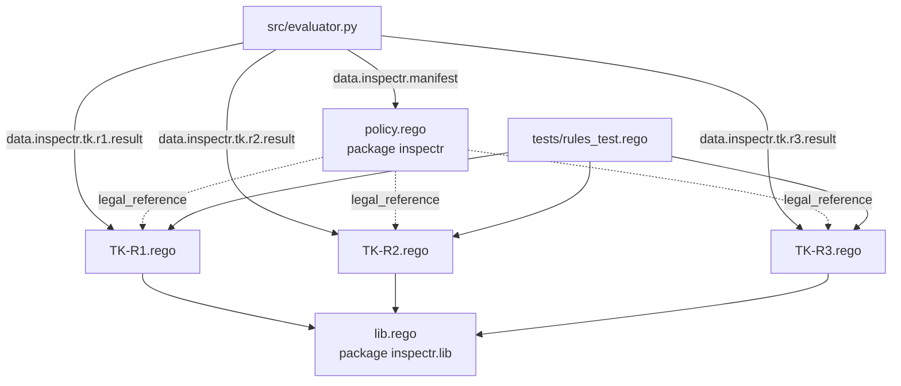
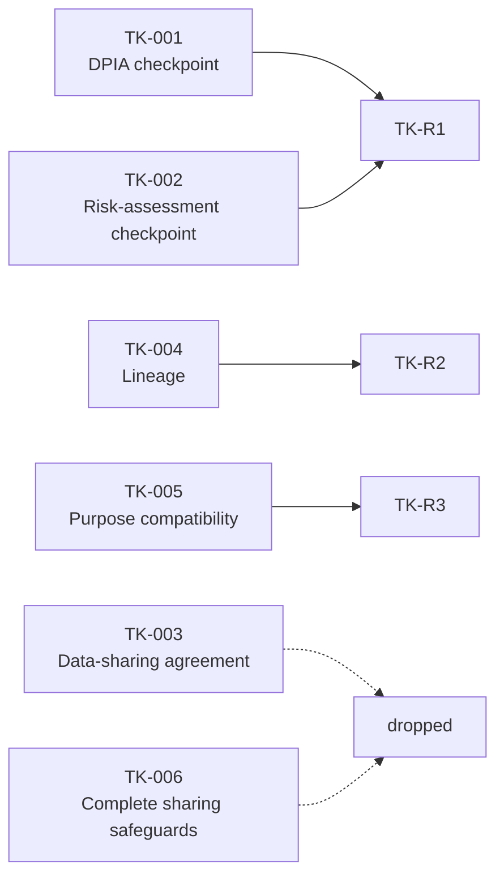

# 4 · Rego policies (`policies/tk/`)

[← Policy engine](03-policy-engine.md) · [Wiki home](README.md) · Next: [Streamlit app →](05-streamlit-app.md)

The executable policy lives in `policies/tk/`. All files use `import rego.v1` (OPA ≥ 1.0). Each rule is a complete **decision table**: rows are evaluated top to bottom, the first match wins, and a `default` result returns `ERROR` if no row matches. The decision table of each rule is also written in the header comment of its Rego file.

| File | Package | Content |
|---|---|---|
| [`lib.rego`](../../policies/tk/lib.rego) | `inspectr.lib` | Shared fact helpers and evidence builder. |
| [`policy.rego`](../../policies/tk/policy.rego) | `inspectr` | `rule_set_version`, `manifest`, aggregated `results`. |
| [`TK-R1.rego`](../../policies/tk/TK-R1.rego) | `inspectr.tk.r1` | DPIA and risk-assessment checkpoint. |
| [`TK-R2.rego`](../../policies/tk/TK-R2.rego) | `inspectr.tk.r2` | Lineage record for integrated data. |
| [`TK-R3.rego`](../../policies/tk/TK-R3.rego) | `inspectr.tk.r3` | Purpose compatibility before sharing personal data. |
| [`tests/rules_test.rego`](../../policies/tk/tests/rules_test.rego) | `inspectr.tk.rules_test` | 29 unit tests, one or more per decision-table row. |



## Shared helpers (`lib.rego`)

Every rule reads blueprint facts through these helpers so that "absent", "null" and "wrong type" are handled the same way everywhere.

| Helper | Meaning |
|---|---|
| `absent` | The marker `"<absent>"`, shown as the observed value when a field is missing. |
| `nodes` | `input.pipeline.nodes`, or `[]`. |
| `nodes_of_type(t)` | Nodes whose `type == t`. Nodes with only a `kind` (raw inLUMEN export) never match. |
| `props(node)` | The node's `properties`, or `{}`. |
| `observed(node, field)` | The property value, or the absent marker. |
| `has_field(node, field)` | The property is present (any value, including `null`). |
| `is_true(node, field)` / `is_false(node, field)` | The property is the JSON boolean `true` / `false`. |
| `not_usable(node, field)` | The property is not a boolean: missing, `null`, `"true"`, `1`, etc. |
| `selector(node, field)` | Evidence path, e.g. `pipeline.nodes[id=="dpia_check"].properties.dpia_checkpoint_defined`. |
| `evidence(node, field, expected, condition)` | One input-evidence entry `{selector, observed, expected, condition}`. |

**Only real JSON booleans count as evidence.** `"true"`, `1` and `null` are treated as undetermined and lead to `UNKNOWN`.

## Manifest (`policy.rego`)

```rego
package inspectr

rule_set_version := "tk-v2.0"

manifest := [
	{"id": "TK-R1", "query": "data.inspectr.tk.r1.result", "legal_reference": data.inspectr.tk.r1.legal_reference},
	{"id": "TK-R2", "query": "data.inspectr.tk.r2.result", "legal_reference": data.inspectr.tk.r2.legal_reference},
	{"id": "TK-R3", "query": "data.inspectr.tk.r3.result", "legal_reference": data.inspectr.tk.r3.legal_reference},
]

results := [data.inspectr.tk.r1.result, data.inspectr.tk.r2.result, data.inspectr.tk.r3.result]
```

`src/evaluator.py` reads `manifest` and queries each rule's `result` separately, so a broken rule becomes `ERROR` for that rule only. `results` is kept for direct use with `opa eval` (see [Getting started](01-getting-started.md#evaluating-a-blueprint-from-the-command-line)).

## TK-R1 · DPIA and risk-assessment checkpoint

| | |
|---|---|
| Replaces | TK-001 (DPIA checkpoint) and TK-002 (risk-assessment checkpoint), which had the same trigger |
| TK requirement | "DPIA / risk assessment": determine whether processing requires a DPIA and assess risk before relevant processing/sharing |
| Legal basis | GDPR Art. 35(1), Art. 35(3)(b), Art. 9 |
| Trigger | Any `data_source` declares `contains_special_category_data: true` |
| Control | One `compliance_gate` declares both `dpia_checkpoint_defined: true` and `risk_assessment_checkpoint_defined: true` |
| Evidence class | Manually declared (M). inLUMEN does not export it today. |

| Row | Condition | Status |
|---|---|---|
| 1 | No source declares `true`, and a source flag is missing/invalid, or there are no data sources | `UNKNOWN` |
| 2 | Every source declares `false` | `NOT_APPLICABLE` |
| 3 | Trigger true, no `compliance_gate` in the design | `FAIL` |
| 4 | Trigger true, a gate declares a control `false` | `FAIL` |
| 5 | Trigger true, one gate declares both controls `true` | `PASS` |
| 6 | Trigger true, controls missing/invalid | `UNKNOWN` |
| 7 | Anything else (should be unreachable) | `ERROR` |

Notes from the rule and from `docs/RULESET-V2-CHANGES.md`:

- One source declaring the trigger `true` makes the obligation apply, even if another source's flag is missing.
- Only gates that carry at least one of the two control fields are considered (`relevant_gates`). Unrelated gates such as `sharing_assessment` are ignored.
- Row 3 is an interpretation awaiting confirmation: a design with special-category data and no compliance gate is `FAIL` (a missing gate is a missing control), not `UNKNOWN`.
- `contains_personal_data` was dropped from the trigger, since special-category data is personal data by definition.
- Derived evidence: `special_category_trigger`, `sources_with_unusable_flag`, `compliance_gates`, `gates_with_both_controls`.

## TK-R2 · Lineage record for integrated data

| | |
|---|---|
| Replaces | TK-004 |
| TK requirement | "Traceability": document data provenance and processing performed during dataset construction |
| Legal basis | GDPR Art. 5(2) (accountability); Art. 30 where applicable |
| Trigger | The design contains a node with `type: data_integration` |
| Control | Every such node declares `lineage_record_defined: true` |
| Evidence class | Declared today; could be derived from inLUMEN runs (D) |

| Row | Condition | Status |
|---|---|---|
| 1 | Input has no `pipeline.nodes` (rejected by `evaluator.py` before OPA) | — |
| 2 | No `data_integration` node | `NOT_APPLICABLE` |
| 3 | An integration node declares the control `false` | `FAIL` |
| 4 | An integration node has the control missing/invalid | `UNKNOWN` |
| 5 | Every integration node declares the control `true` | `PASS` |
| 6 | Anything else (should be unreachable) | `ERROR` |

Known limit (from the file header): a raw inLUMEN export uses `kind`, not `type`, so it has no `data_integration` node and returns `NOT_APPLICABLE`. That is a correct reading of the input but not of the pipeline; the planned adapter (RQ2) fixes it. Derived evidence: `integration_nodes`, `nodes_with_control_false`, `nodes_with_control_unusable`.

## TK-R3 · Purpose compatibility before sharing

| | |
|---|---|
| Replaces | TK-005 |
| TK requirement | "Lawfulness": requests from researchers, companies and other consumers who want data for new purposes |
| Legal basis | GDPR Art. 5(1)(b) (purpose limitation), Art. 6(4) (compatibility) |
| Trigger | A `data_transfer` node exists **and** some `data_source` declares `contains_personal_data: true` |
| Control | `purpose_compatibility_declared` on a `compliance_gate`. Gates that do not carry the field are ignored. |
| Evidence class | Legal judgement (H): can be declared, never derived. There is deliberately **no PASS**; the best outcome is `HUMAN`. |

| Row | Condition | Status |
|---|---|---|
| 1 | Transfer exists, no source declares personal data `true`, and a source flag is missing/invalid or there are no sources | `UNKNOWN` |
| 2 | No transfer node, or every source declares `false` | `NOT_APPLICABLE` |
| 3 | Applies, a gate declares the control `false` | `FAIL` |
| 4 | Applies, no gate carries the field, or it is invalid | `UNKNOWN` |
| 5 | Applies, every gate carrying the field declares `true` | `HUMAN` |
| 6 | Anything else (should be unreachable) | `ERROR` |

Derived evidence: `transfer_nodes`, `sources_with_unusable_flag`, `gates_carrying_control`, `gates_with_control_false`. The test `test_r3_never_pass` asserts that no input yields `PASS`.

## Results on the V2 blueprint

| Rule | Status | Row | Why |
|---|---|---|---|
| TK-R1 | `PASS` | 5 | `health_services` declares special-category data; gate `dpia_check` declares both checkpoints. |
| TK-R2 | `PASS` | 5 | The only integration node, `integrate_dataset`, declares a lineage record. |
| TK-R3 | `HUMAN` | 5 | `share_dataset` is a transfer, sources declare personal data, and `sharing_assessment` declares purpose compatibility `true`; an expert must confirm. |

## Ruleset v2 changes

Summary of [`docs/RULESET-V2-CHANGES.md`](../RULESET-V2-CHANGES.md) (rule set `tk-v2.0`, 2 November 2026). The six v1 rules (TK-001 … TK-006, listed in `archive-files.txt`) were reduced to three, and the status model grew from three statuses (PASS, FAIL, HUMAN) to six (adding UNKNOWN, NOT_APPLICABLE, ERROR).



| v1 rule | v2 outcome | Reason |
|---|---|---|
| TK-001, TK-002 | Merged into TK-R1 | Same trigger; differed only in the field they checked. |
| TK-003 | Dropped | Kept scope small; can return as TK-R4 with the structure of TK-R1. |
| TK-004 | Replaced by TK-R2 | |
| TK-005 | Replaced by TK-R3 | |
| TK-006 | Dropped | Depended on hard-coded node IDs and mostly re-checked other rules. |

Reducing to three rules was a research-quality decision: each status can be tested exhaustively, and each rule stands for one evidence class (declared, derivable, judgement).

Smaller changes:

- Dropped undocumented fallback fields `dpia_completed`, `risk_assessment_completed`, `data_sharing_agreement_exists`, `lineage_available`, `purpose_compatible`.
- Only real JSON booleans count as evidence.
- Each result gained `title` and `decision_row`.

### Defects D1–D5

| ID | Defect in v1 | Effect | Fix in v2 |
|---|---|---|---|
| D1 | A missing control field left no matching branch, so the rule was undefined; `policy.rego` built one array from all six rules, so the whole array became undefined. | Removing `dpia_checkpoint_defined` from V2 returned no results for any rule. | Explicit `UNKNOWN` row and `default` `ERROR` in every rule; `evaluator.py` queries each rule separately. |
| D2 | A missing trigger fell into the "not required" branch, which returned PASS. | Removing `contains_special_category_data` gave TK-001 and TK-002 a **false PASS**. | Rows 1 and 2 of TK-R1 and TK-R3 separate "trigger missing/invalid" (`UNKNOWN`) from "trigger declared false" (`NOT_APPLICABLE`). |
| D3 | TK-005 returned HUMAN as soon as any gate lacked `purpose_compatibility_declared`. | HUMAN on V2 for the wrong reason (`dpia_check`, not `sharing_assessment`). | TK-R3 ignores gates that do not carry the field. |
| D4 | "Not applicable" branches reported PASS with evidence not in the blueprint. | Five vacuous PASS results on the raw inLUMEN export. | `NOT_APPLICABLE` or `UNKNOWN` instead; derived evidence lists only what was examined; TK-R3 has no PASS path. |
| D5 | `evaluator.py` called OPA at `C:\Tools\OPA\opa.exe`. | Not runnable outside one Windows machine. | `OPA_PATH`, then `PATH`, then the old path. |

### Measured behaviour, before and after

| Input | v1 (6 rules) | v2 (3 rules) |
|---|---|---|
| V2 blueprint as is | 5 × PASS, TK-005 HUMAN (accidental, D3) | R1 PASS, R2 PASS, R3 HUMAN |
| V2 with `dpia_checkpoint_defined: false` | TK-001 FAIL, TK-006 FAIL | R1 FAIL, R2 PASS, R3 HUMAN |
| V2 with `dpia_checkpoint_defined` removed | No results at all (D1) | R1 UNKNOWN, R2 PASS, R3 HUMAN |
| V2 with `contains_special_category_data` removed | TK-001 and TK-002 PASS (false PASS, D2) | R1 UNKNOWN, R2 PASS, R3 HUMAN |
| Raw inLUMEN export | 5 × PASS, TK-006 FAIL (vacuous, D4) | R1 UNKNOWN, R2 NOT_APPLICABLE, R3 NOT_APPLICABLE |

## Adding or changing a rule

Based on `.github/copilot-instructions.md` and the existing layout:

1. Write `policies/tk/TK-RN.rego` in package `inspectr.tk.rN`, reading facts only through `lib.rego`. Give it a header with requirement, legal basis, trigger, control, evidence class and decision table, a complete `result` chain and a `default result` with status `ERROR`.
2. Register it in `manifest` and `results` in `policy.rego`.
3. Add one or more tests per decision-table row in `tests/rules_test.rego`, and run `opa test policies/tk -v`.
4. Describe the rule in `RULES` (and `RULE_FACTS`) in `src/catalog.py`, and add it to `data/inspectr_taxonomy.json`. `test_catalog_matches_rego_manifest` and `test_taxonomy_matches_catalog` fail until they agree.
5. Add the new rule's expected status to every scenario in `src/scenarios.py`, then run `pytest tests -v`.
