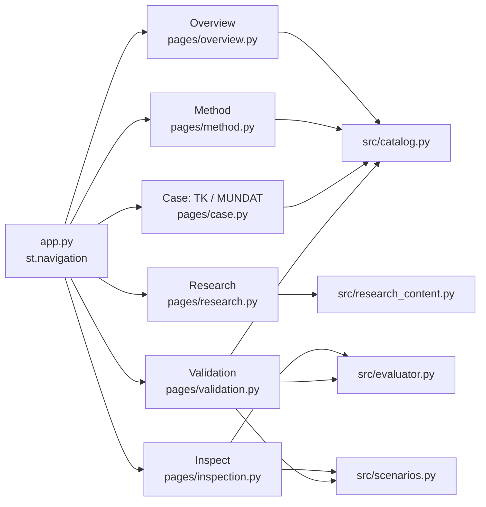
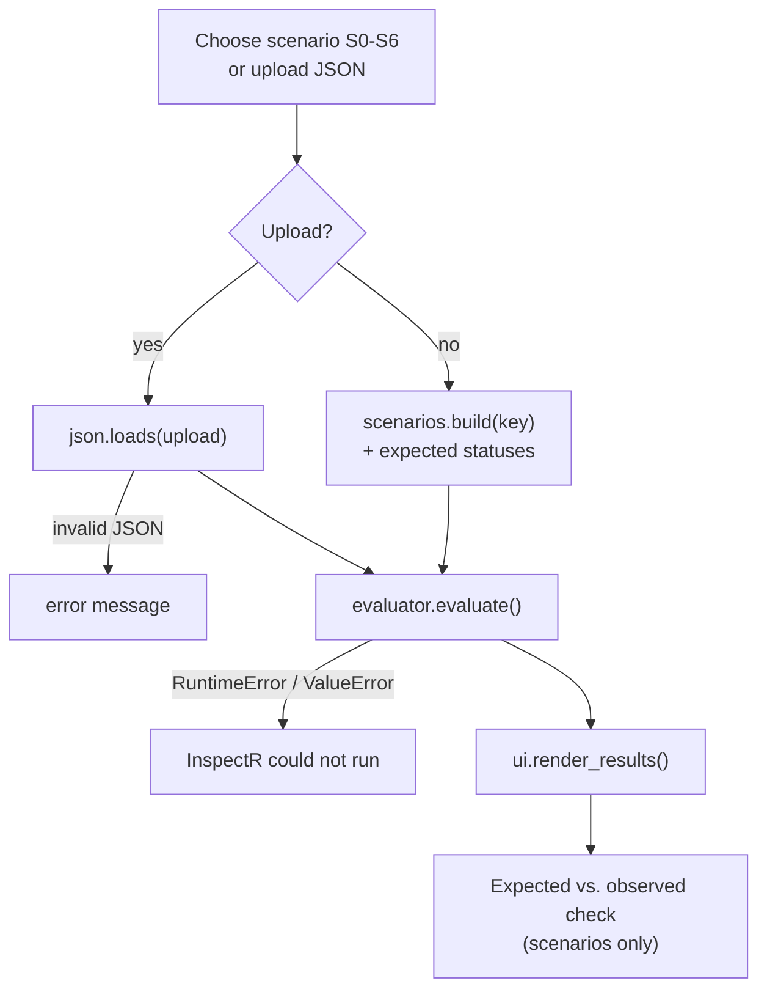

# 5 · Streamlit app (`app.py`, `pages/`)

[← Rego policies](04-rego-policies.md) · [Wiki home](README.md) · Next: [Data and blueprints →](06-data-and-blueprints.md)

The user interface is a multi-page Streamlit app. It explains the research, shows the case, runs inspections through the evaluator, and presents the validation evidence. Page content about rules and statuses is read from `src/catalog.py`, so it stays consistent with the Rego rules.

Start it from the repository root with `streamlit run app.py` (see [Getting started](01-getting-started.md#5-start-the-app)).

## App shell (`app.py`)

| Section | What it does |
|---|---|
| Configuration | `st.set_page_config(page_title="InspectR \| PoC", layout="wide", initial_sidebar_state="expanded")`. |
| Global CSS | One CSS block for the whole app: larger sidebar navigation text, reduced top padding on every page, and a reusable `.custom-card` class. |
| Session state | Initialises `st.session_state["blueprint"]` and `st.session_state["blueprint_filename"]` to `None`. |
| Navigation | `st.navigation` over six `st.Page` entries (below). Overview is the default page. Earlier exploratory pages stay in `pages/archive/` and are not shown. |
| Sidebar | DataPACT and UiO logos (`images/datapact-logo.png`, `images/uio.png`) and the caption "InspectR · iteration 1 · rule set tk-v2.0". |

Every page starts with `page_header(title, question)` from `src/ui.py`: a title plus the single question the page answers.

## Pages in the navigation

| Nav title | File | Question it answers |
|---|---|---|
| Overview | `pages/overview.py` | Design-time compliance inspection of data-pipeline blueprints (project intro) |
| Research | `pages/research.py` | What is known, what is missing, and what can InspectR add? |
| Method | `pages/method.py` | How does a written requirement become a machine-checkable verdict? |
| Case: TK / MUNDAT | `pages/case.py` | Which pipeline is inspected, and what evidence does its blueprint provide? |
| Inspect | `pages/inspection.py` | What does InspectR conclude for a given blueprint, and on what evidence? |
| Validation | `pages/validation.py` | How do we know the results are correct, and where are the limits? |

### Overview (`pages/overview.py`)

- Short description: InspectR checks a *planned* pipeline against compliance rules *before it is built* and returns one traceable result per rule.
- **Problem**, in three cards: missing tooling for design-time privacy compliance, Policy-as-Code with OPA mostly targeting infrastructure rather than data/AI pipelines, and inLUMEN exports lacking compliance evidence. Each card links to its sources.
- **Research questions**: main RQ plus RQ1–RQ3.
- **Artefact (iteration 1)**: a Graphviz diagram (TK requirement → Rego rule; blueprint → OPA → result per rule) and metrics for the number of rules, statuses and use cases (from `src/catalog.py`).
- **Method and scope**: Design Science Research (Hevner et al., 2004), in-scope / out-of-scope table, and what is and is not claimed as a contribution.

### Research (`pages/research.py`)

Presents one argument chain, *key works → gaps → research questions → candidate contributions → evaluation*, using `src/research_content.py`. A local `md_table()` helper renders Markdown tables so that long text wraps and links stay clickable. Sections: key works, research gaps, research questions with candidate sub-questions, candidate contributions, evaluation metrics (from the Scope and Evaluation Proposal, 30 October 2026), and possible research directions.

### Method (`pages/method.py`)

- **From requirement to verdict**: five steps (Requirement → Rule → Facts → Evaluation → Result).
- **Decision logic**: the shared trigger/control table and the status model (from `STATUS_MODEL`).
- **Worked example: TK-R1** in five tabs: the TK requirement, the IF/THEN rule, a Rego excerpt of the decision chain, the facts in V2 (`health_services`, `citizen_registry`, `dpia_check`), and the resulting `PASS` at decision-table row 5.
- Expanders with **Definitions** and **Design decisions and justification** (see [Architecture → design decisions](02-architecture.md#design-decisions)).

### Case: TK / MUNDAT (`pages/case.py`)

- Describes the **Sickleave** scenario at Trondheim Kommune.
- **Pipeline design**: a Graphviz diagram generated from `data/tk_mundat_data_sharing_v2.json`. Nodes the rules read are coloured and labelled with the rule IDs; `metadata` and `authorisation` flows are dashed.
- **Native export vs. enriched blueprint**: node counts and kinds of the raw inLUMEN export compared with V2, computed from the files, plus the `RULE_FACTS` table with provenance codes S / D / M / H.
- **Rule set** table from `RULES`, and an expander with the rules dropped from iteration 1 (`DROPPED_RULES`).

### Inspect (`pages/inspection.py`)

The interactive inspection page.

1. A horizontal radio selects one of the scenarios S0–S6 from `src/scenarios.py`, or **Upload a blueprint**.
2. For a scenario, `build(key)` produces the blueprint and the page shows the change from V2. For an upload, the file must be UTF-8 JSON; decoding errors are shown inline.
3. `evaluate(blueprint)` runs under a spinner. `RuntimeError` (OPA unavailable) or `ValueError`/`InputError` (unreadable blueprint) is shown as "InspectR could not run: …".
4. `render_results(results, expected)` shows the status counts and one expander per rule. For scenarios, each rule is marked `✓ as expected` or `✗ expected …`, followed by an overall success or error banner.
5. An expander shows the exact blueprint JSON submitted to OPA.

### Validation dashboard (`pages/validation.py`)

- **Scenario matrix**: `run_matrix()` (cached with `st.cache_data`) evaluates every scenario with OPA and builds a table of observed statuses per rule, each marked `✓` or `✗ expected …`. A caption reports how many results match (21/21 on the current rule set). If OPA is missing, the page shows "OPA is not available".
- **What iteration 1 revealed**: the defects table D1–D5 from `src/catalog.py`.
- **Acceptance criteria** AC1–AC7 with status and notes.
- **Limits of validity**: PASS is design-level; rules are interpretations; evidence is declared, not verified; raw inLUMEN exports are read literally.
- **Open questions for SINTEF** from `OPEN_QUESTIONS`.

| ID | Acceptance criterion | Status |
|---|---|---|
| AC1 | Native inLUMEN export accepted through an adapter; manual enrichment listed separately. | Open |
| AC2 | Policy packs for three use cases without engine changes. | Open |
| AC3 | Every finding has rule ID, status, policy-source reference, evidence path, reason, remedy. | Met |
| AC4 | Uniform result semantics; missing information gives UNKNOWN, never PASS. | Met |
| AC5 | `opa test` cases for pass, fail, missing and not-applicable per rule. | Met |
| AC6 | Reproducible through Docker and CLI, deterministic output. | Partial (no Docker image yet) |
| AC7 | Domain expert review of a policy sample. | Open |

## Archived pages (`pages/archive/`)

Earlier exploratory pages, kept for reference and **not registered in `app.py`**. Several were updated during the v2 change to use `src/catalog.py` (see `docs/RULESET-V2-CHANGES.md`, "App and documentation consistency"), but they are no longer maintained as part of the app. The v1 paths of these files, from before they were moved, are listed in `archive-files.txt`.

| File | Former purpose |
|---|---|
| `about.py` | About InspectR: Design Science Research framing and the parts of the artefact. |
| `architecture.py` | Architecture overview using `images/arch-inspectr.jpeg`, with a note that no IR is built. |
| `datapipeline.py` | Teaching page "Understanding Data Pipelines": how data moves, graphs, and where compliance risks emerge. |
| `evaluation.py` | Earlier evaluation page: upload, hashing of the upload to invalidate stale results, status counts, evidence rendering. Replaced by Inspect. |
| `evidence.py` | Evidence traceability per rule (trigger, control, selectors, every status, boundary) from the catalogue. |
| `main.py` | Earlier landing page ("A Framework for Compliance Automation"). Replaced by Overview. |
| `pac.py` | Policy-as-Code page: TK/MUNDAT rule mapping and result semantics from the catalogue; dropped rules. |
| `research.py` | Earlier research problem and research questions page. Replaced by the new `pages/research.py`. |
| `taxonomy.py` | Plotly visualisation of `data/inspectr_taxonomy.json` (the only use of `plotly`). |
| `tk_uc.py` | Earlier TK use-case page for the Sickleave scenario. Replaced by Case: TK / MUNDAT. |

To show an archived page again, add an `st.Page("pages/archive/<file>.py", title=...)` entry to the `pages` list in `app.py`. Check it first, since archived pages may refer to older content.
