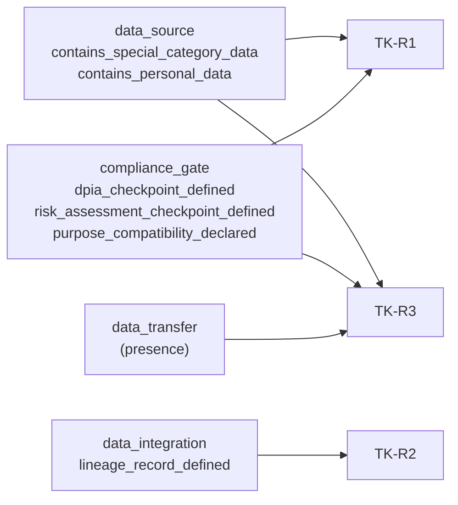
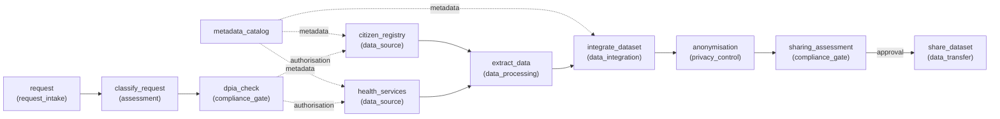

# 6 · Data and blueprints

[← Streamlit app](05-streamlit-app.md) · [Wiki home](README.md) · Next: [Testing and tooling →](07-testing-and-tooling.md)

A **blueprint** is a machine-readable JSON description of a planned pipeline. InspectR evaluates it directly; there is no intermediate representation in the PoC.

| File | Content | Role |
|---|---|---|
| `data/tk_mundat_data_sharing_v2.json` | Enriched blueprint: 11 typed nodes, 13 connections, compliance facts added manually. | Main evaluation input (scenario S0 and the base for S1–S5). |
| `data/tk_mundat_data_sharing_v1.json` | Earlier enriched blueprint (11 nodes, 12 connections) that includes an `education_system` source. | Historical; not used by the current code. |
| `data/inspectr_taxonomy.json` | Tree of the policy scope: root `TK.MUNDAT.PolicyScope` with one child per rule (TK-R1 … TK-R3). | Read by the archived taxonomy page; checked against the catalogue by a test. |
| `tk-uc/inlumen-tk-uc.json` | Raw inLUMEN export (`inlumen.project@2`): 7 nodes, generic `kind`, empty `parameters`. | Shows what tooling exports today (scenario S6). |
| `tk-uc/…` | inLUMEN chat and provenance exports, TK use-case document, executive summary. | Source material for the case. |

## Blueprint schema

The evaluator requires only the minimum shape below (`_validate_input` in `src/evaluator.py`). Anything else is read by the rules through `lib.rego`, where a missing or non-boolean fact is **undetermined**.

```json
{
  "pipeline": {
    "nodes": [
      { "id": "health_services", "type": "data_source", "properties": { "contains_special_category_data": true } }
    ],
    "connections": [
      { "from": "dpia_check", "to": "health_services", "flow_type": "authorisation" }
    ]
  }
}
```

| Path | Required by | Notes |
|---|---|---|
| `pipeline` | Evaluator | Must be an object. |
| `pipeline.nodes` | Evaluator | Must be a list. |
| `pipeline.nodes[].id` | Evaluator | Must be a string; used in evidence selectors. |
| `pipeline.nodes[].type` | Rules | Node type. The rules read `data_source`, `compliance_gate`, `data_integration` and `data_transfer`. |
| `pipeline.nodes[].properties` | Rules | Object of facts. Only JSON booleans count as evidence. |
| `pipeline.connections` | Case page only | `{from, to, flow_type}`; used to draw the pipeline diagram. No rule reads connections. |

Facts the rules read:

| Node type | Property | Read by | Role |
|---|---|---|---|
| `data_source` | `contains_special_category_data` | TK-R1 | Trigger |
| `data_source` | `contains_personal_data` | TK-R3 | Trigger |
| `compliance_gate` | `dpia_checkpoint_defined` | TK-R1 | Control |
| `compliance_gate` | `risk_assessment_checkpoint_defined` | TK-R1 | Control |
| `compliance_gate` | `purpose_compatibility_declared` | TK-R3 | Control |
| `data_integration` | (node exists) | TK-R2 | Trigger |
| `data_integration` | `lineage_record_defined` | TK-R2 | Control |
| `data_transfer` | (node exists) | TK-R3 | Trigger |



## Enriched blueprint V2 (`data/tk_mundat_data_sharing_v2.json`)

Pipeline metadata: `id: tk_mundat_data_sharing_v2`, `name: Municipal Data Sharing Workflow`, `case_dataset: Sickleave` ("Aggregated and anonymised research dataset assembled from municipal health-services and registry sources"). The IoT stormwater sensor dataset is listed under `excluded_case_datasets` because it is not part of this sensitive personal-data sharing scenario.

| Node `id` | `type` | Key properties |
|---|---|---|
| `request` | `request_intake` | `request_id: REQ-2026-MUNDAT`, `requester_identity: academic_research_group`, `purpose_specified: sickleave_trend_analysis` |
| `classify_request` | `assessment` | `personal_data_expected: true`, `special_category_data: true`, `children_data: false` |
| `dpia_check` | `compliance_gate` | **`dpia_checkpoint_defined: true`**, **`risk_assessment_checkpoint_defined: true`**, `dpia_required: true` |
| `metadata_catalog` | `metadata_catalog` | `catalog_id: catalog:trondheim-mundat`; records dataset identity, owner, schema, sensitivity, lineage, provenance |
| `health_services` | `data_source` | **`contains_personal_data: true`**, **`contains_special_category_data: true`**, `schema_fields` (e.g. `sick_leave_reasons`), `infrastructure_config` |
| `citizen_registry` | `data_source` | **`contains_personal_data: true`**, **`contains_special_category_data: false`**, `schema_fields` (e.g. `national_id`, hashed) |
| `extract_data` | `data_processing` | `purpose_limitation_defined`, `data_minimisation_defined`, `audit_logging_configured` |
| `integrate_dataset` | `data_integration` | **`lineage_record_defined: true`**, `provenance_record_defined`, `lineage_record_id: lineage:tk-mundat-sickleave-v2` |
| `anonymisation` | `privacy_control` | `anonymisation_control_defined`, `reidentification_risk_checkpoint_defined` |
| `sharing_assessment` | `compliance_gate` | **`purpose_compatibility_declared: true`**, contract / recipient-approval / data-sharing-agreement checkpoints |
| `share_dataset` | `data_transfer` | `encryption_in_transit_configured`, `recipient_approval_declared`, `sink_destination` |

Facts in **bold** are the ones the rules read. The others document the design but are not evaluated in iteration 1.



Source names, schemas and configuration values in V2 are illustrative modelling assumptions, not confirmed details of municipal systems (root `README.md`).

## Raw inLUMEN export (`tk-uc/inlumen-tk-uc.json`)

Exported from the inLUMEN pipeline editor (`schema_version: inlumen.project@2`, exported 7 September 2026). It was generated from the prompt in `tk-uc/inlumen-chat-2026-09-07T13-33-47-037Z.md`, which asks for a linear Trondheim Kommune compliance flow.

| `id` | `kind` | `label` | `description` |
|---|---|---|---|
| 1 | source | `tk_request_intake` | Intake of compliance request from Trondheim Kommune |
| 2 | task | `validate_request` | Check request structure and metadata completeness |
| 3 | task | `retrieve_relevant_data` | Find datasets needed for the request |
| 4 | task | `process_data_for_compliance` | Prepare data for legal checks |
| 5 | task | `run_compliance_checks` | Execute sector law, DPIA, and obligations checks |
| 6 | task | `prepare_sharing_decision` | Generate decision support (YES/NO) |
| 7 | destination | `tk_decision_output` | Output decision result for Trondheim Kommune compliance |

Nodes carry `template`, `position`, `inputs`, `outputs` and an empty `parameters` object. Connections use React Flow edge IDs with `{node, port}` endpoints.

### The enrichment gap (RQ1)

The difference between the raw export and V2 is a research finding: it measures the gap between what pipeline tooling exports and what inspection needs.

| Aspect | Raw inLUMEN export | Enriched V2 |
|---|---|---|
| Nodes | 7 | 11 |
| Node classification | `kind`: source / task / destination | `type`: domain-specific (e.g. `data_source`, `compliance_gate`) |
| Compliance facts | None (`parameters` empty) | Added manually |
| InspectR result | TK-R1 UNKNOWN, TK-R2 NOT_APPLICABLE, TK-R3 NOT_APPLICABLE | TK-R1 PASS, TK-R2 PASS, TK-R3 HUMAN |

Because `lib.nodes_of_type()` matches on `type`, the raw export has no `data_integration` or `data_transfer` node, and TK-R2 and TK-R3 return `NOT_APPLICABLE`. That is a correct reading of the input but not of the pipeline. A planned adapter (RQ2, acceptance criterion AC1) would map native exports to the evidence model.

## `tk-uc/` source material

| File | Content |
|---|---|
| `TK Use Case.docx` | Trondheim Kommune use-case document (MUNDAT). |
| `inlumen-tk-uc.json` | Raw inLUMEN export (above). |
| `inlumen-chat-2026-09-07T13-33-47-037Z.md` | inLUMEN Pipeline Copilot chat that produced the export. |
| `inlumen-provenance-main.jsonld` | W3C PROV (JSON-LD) provenance from inLUMEN: pipeline states and versions, modifications, user queries, human and software agents. |
| `inlumen-provenance-tk-uc.pdf` | inLUMEN Provenance Report (generated 7 Sep 2026) for the "Trondheim Kommune Compliance Flow" pipeline, with its modification log. |
| `stat.md` | Executive summary and current status of the PoC on V2. |

The repository root also contains `TK_MUNDAT_blueprint_and_rules_analysis.pdf`, a plain-language analysis of the TK description, the V2 blueprint and the Rego rules. It describes the six v1 rules, so it predates rule set `tk-v2.0`.

## Taxonomy (`data/inspectr_taxonomy.json`)

A tree with root `TK.MUNDAT.PolicyScope` ("Three design-time TK/MUNDAT policy rules evaluated by the InspectR PoC (rule set tk-v2.0)"). Each child is a rule with `rule_id`, `label`, `description` (the IF/THEN statement), `legal_references`, `relationship` and `evidence_fields`. `test_taxonomy_matches_catalog` checks that its rule IDs match `src/catalog.py`.

## Writing your own blueprint

1. Start from `data/tk_mundat_data_sharing_v2.json`.
2. Give every node a unique string `id` and a `type` from the table above for the parts the rules should read.
3. Declare facts as JSON booleans (`true`/`false`, not `"true"` or `1`).
4. Upload it on the **Inspect** page, or run `opa eval` (see [Getting started](01-getting-started.md#evaluating-a-blueprint-from-the-command-line)).

If a fact is missing, the result is `UNKNOWN` with a remedy that names the field to declare.
