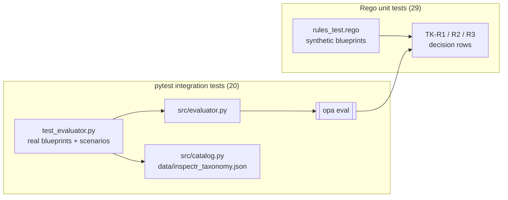

# 7 · Testing and tooling

[← Data and blueprints](06-data-and-blueprints.md) · [Wiki home](README.md) · Next: [Glossary →](08-glossary.md)

InspectR has two test suites. They test different layers and both run against real OPA.

| Suite | Location | Runner | Count | Needs |
|---|---|---|---|---|
| Rego unit tests | `policies/tk/tests/rules_test.rego` | `opa test policies/tk -v` | 29 | OPA |
| Python integration tests | `tests/test_evaluator.py` | `pytest tests -v` | 20 | Python, pytest, OPA |



## Rego unit tests

```bash
opa test policies/tk -v      # expected: PASS: 29/29
```

The file states its intent: *one test per decision-table row of TK-R1, TK-R2 and TK-R3.* It builds small synthetic blueprints with helpers (`bp(nodes)`, `src(id, props)`, `gate(id, props)`, `integ(id, props)`, `transfer`, plus fixtures such as `sensitive`, `ordinary`, `non_personal`, `dpia_ok`). Each test checks both the status and the `decision_row` via `check(res, status, row)`.

| Rule | Tests | Covered rows | Notable cases |
|---|---|---|---|
| TK-R1 | 14 | 1–6 | Trigger missing, wrong type, `null`, no sources; one `true` source wins over a missing flag elsewhere; unrelated gates ignored; the D1 "control removed" shape. |
| TK-R2 | 5 | 2–5 | No integration node, `false`, missing, wrong type, pass. |
| TK-R3 | 10 | 1–5 | Personal-data flag missing, no sources, no transfer, no personal data, `false`, no gate carries the field, wrong type, `HUMAN`; the D3 case (DPIA gate ignored); `test_r3_never_pass`. |

Only the `default` `ERROR` results are uncovered, and those should be unreachable (`docs/RULESET-V2-CHANGES.md`).

## Python integration tests

```bash
OPA_PATH=/path/to/opa pytest tests -v      # expected: 20 passed
```

`tests/conftest.py` adds the repository root to `sys.path` so `from src import evaluator` works. `tests/test_evaluator.py` loads the real V2 blueprint and raw inLUMEN export.

| Test | What it checks |
|---|---|
| `test_v2_baseline` | V2 gives TK-R1 PASS, TK-R2 PASS, TK-R3 HUMAN. |
| `test_raw_inlumen_export_gives_no_vacuous_pass` | Raw export: TK-R1 UNKNOWN and no PASS anywhere (D4). |
| `test_control_false_is_fail` | `dpia_checkpoint_defined: false` gives TK-R1 FAIL. |
| `test_removed_control_no_longer_wipes_results` | D1 regression: removing the control gives UNKNOWN, and all three results are still returned. |
| `test_removed_trigger_is_unknown_not_pass` | D2 regression: removing the special-category flag gives UNKNOWN, not PASS. |
| `test_unreadable_blueprint_is_input_error` (×4) | `[]`, `{"pipeline": []}`, `{"pipeline": {}}` and a node without `id` raise `InputError`. |
| `test_broken_rule_is_error_for_that_rule_only` | Copies the policies to a temp dir, injects a conflicting TK-R2, and checks TK-R2 ERROR while TK-R1 PASS and TK-R3 HUMAN are kept. |
| `test_missing_opa_is_runtime_error` | A missing OPA binary raises `RuntimeError`. |
| `test_catalog_matches_rego_manifest` | `src/catalog.py` lists the same rule IDs and legal references as the Rego manifest, and every catalogued outcome is a valid status. |
| `test_taxonomy_matches_catalog` | `data/inspectr_taxonomy.json` lists the same rule IDs as the catalogue. |
| `test_demo_scenarios_match_expected` (×7) | Each scenario S0–S6 in `src/scenarios.py` produces its expected statuses. |

`docs/RULESET-V2-CHANGES.md` mentions 13 pytest tests. That was the count when the document was written; the scenario tests were added later, giving the current 20.

## Other checks

- **Live regression in the app.** The Validation page re-runs every scenario through OPA and reports how many results match the expected status (7 scenarios × 3 rules = 21). The Inspect page marks each result `✓ as expected` or `✗ expected …` (`render_results` in `src/ui.py`) and says whether they all match.
- **Command-line evaluation.** `opa eval … data.inspectr.results` evaluates a blueprint without Python (see [Getting started](01-getting-started.md#evaluating-a-blueprint-from-the-command-line)).
- **No CI, linter or Docker image yet.** There is no workflow under `.github/workflows/`. AC6 (Docker/CLI reproducibility) is Partial.

## Repository hygiene and assets

| Path | What it is | Notes |
|---|---|---|
| `README.md` | Main project README. | Primary overview; the wiki expands on it. |
| `PoC.md` | What "correct" and "novel" mean for the PoC; agreed boundary (no IR). | |
| `Logg.md` | Development log: design-time rationale, MUNDAT case, an earlier review summary ("InspectR Review Summary 260926"), history of earlier rule sets. | Historical; describes rules that no longer exist. |
| `README-backup-1.md` … `-3.md` | Earlier README versions. | Not updated for v2. |
| `docs/RULESET-V2-CHANGES.md` | Changes from v1 to `tk-v2.0`. | See [Rego policies](04-rego-policies.md#ruleset-v2-changes). |
| `archive-files.txt` | v1 paths of the files moved to `pages/archive/` and of the removed `TK-001` … `TK-006` rules. | |
| `ruleset-v2.patch` | Patch file for the v2 change. | Kept for reference. |
| `assets/aia_poc_rules.json` | Early EU AI Act PoC rule catalogue (`inspectr-aia-poc`, v0.1). | Supplementary; not the runtime policy input. |
| `images/` | Figures and logos (`datapact-logo.png`, `uio.png`, `arch-inspectr.jpeg`, `pac-concept.jpg`, …). | Also holds copies of source files (`images/src/`, `images/pages/`, `images/policies/`, `images/tests/`, `images/app.py`, `images/README.md`, …). Some are identical to the live files and some (e.g. `app.py`, `README.md`) differ. They are not used by the app. `images/DELETE-THESE-FILES.txt` lists the same v1 paths as `archive-files.txt`. |
| `src/__pycache__/`, `tests/__pycache__/` | Compiled Python bytecode. | Tracked in git (there is no `.gitignore`); could be removed and ignored. |
| `.github/copilot-instructions.md` | Repository guidelines for AI assistants, including conventions for adding a rule. | Some commands still refer to the fixed Windows OPA path. |
| `.claude/agents/`, `.vscode/` | Editor and agent configuration. | |

Architecture images in `images/` may still show the old PASS / FAIL / HUMAN statuses (noted in `docs/RULESET-V2-CHANGES.md`).
