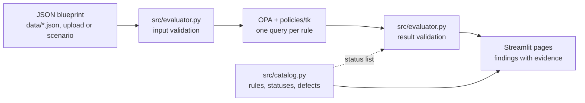
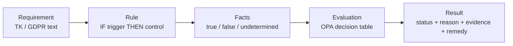
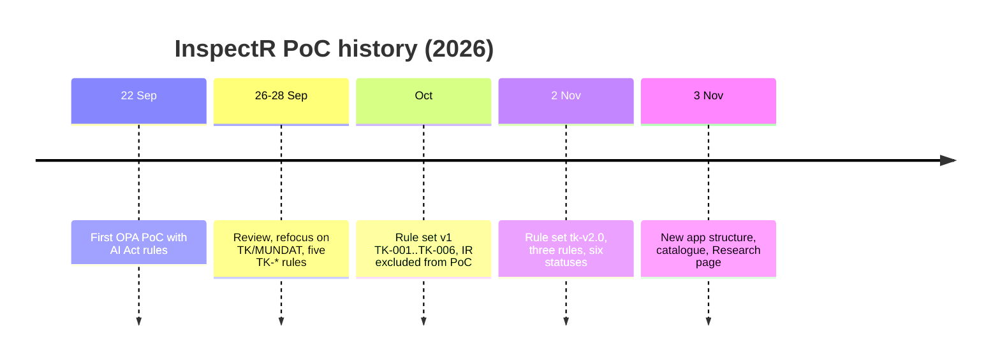

# InspectR Wiki

Design-time compliance inspection of data-pipeline blueprints with Policy-as-Code (OPA/Rego).

This wiki documents the InspectR proof of concept (iteration 1, rule set `tk-v2.0`). It is written from the source files in this repository; where a page summarises a file, the file remains the authority.

> **Assurance boundary.** InspectR checks what a blueprint *declares* against encoded interpretations of selected requirements. It does not establish legal compliance, completed assessments or approvals, or the runtime behaviour of controls. The rules are author interpretations and have not yet been reviewed by SINTEF, TK or legal experts.

## Contents

| # | Page | What it covers |
|---|---|---|
| — | [Home / Overview](README.md) (this page) | Project intro, getting started, architecture and history in brief |
| 1 | [Getting started](01-getting-started.md) | Installing dependencies, locating OPA, running the tests and the app |
| 2 | [Architecture](02-architecture.md) | Evaluation flow and how the components map onto it |
| 3 | [Policy engine (`src/`)](03-policy-engine.md) | Evaluator and OPA integration, rule catalogue and status model, scenarios, UI helpers |
| 4 | [Rego policies (`policies/tk/`)](04-rego-policies.md) | Shared helpers, manifest, TK-R1, TK-R2, TK-R3, ruleset v2 changes and defects D1–D5 |
| 5 | [Streamlit app](05-streamlit-app.md) | `app.py` shell and the pages in `pages/` (including archived pages) |
| 6 | [Data and blueprints](06-data-and-blueprints.md) | Blueprint schema, enriched V2 blueprint, inLUMEN exports, `tk-uc/` source material |
| 7 | [Testing and tooling](07-testing-and-tooling.md) | pytest integration tests, Rego unit tests, repository hygiene and assets |
| 8 | [Glossary](08-glossary.md) | Terms used across the project |

## What InspectR is

InspectR is an MSc thesis artefact (Design Science Research), Department of Informatics, University of Oslo, built in collaboration with SINTEF within DataPACT. The case is MUNDAT at Trondheim Kommune (TK).

Compliance requirements for data pipelines, for example GDPR obligations in the TK documents, are written in natural language and checked manually, late, and without traceability to the pipeline design. InspectR investigates how selected requirements can be made machine-checkable against a pipeline **blueprint** before the pipeline is built:

1. A requirement is scoped as a rule: **IF trigger THEN control**.
2. The rule reads typed facts from a JSON blueprint. Each fact is `true`, `false` or **undetermined** (absent, `null`, or not a boolean).
3. Open Policy Agent (OPA) applies the rule's decision table, written in Rego.
4. The result is one status per rule, with a reason, evidence and a remedy.

The six statuses are `PASS`, `FAIL`, `UNKNOWN`, `HUMAN`, `NOT_APPLICABLE` and `ERROR`. An undetermined fact never produces `PASS`, and `PASS` means "the design declares the control", not "the pipeline is compliant". See [Policy engine → status model](03-policy-engine.md#status-model).

The project's own definition (from `PoC.md`): InspectR is a proof-of-concept architecture for design-time AI and data-pipeline compliance tooling. The PoC deliberately omits an Intermediate Representation (IR) and evaluates the blueprint directly with OPA/Rego.

### Research questions

**Main RQ.** How can a design-time policy engine be architected to inspect compliance properties of data/AI pipeline blueprints in a way that is traceable, reliable and independent of the use case and pipeline tool?

| RQ | Focus |
|---|---|
| RQ1 · Evidence model | What compliance-relevant information must a blueprint contain for policy-based inspection, and how much can pipeline tooling derive versus manual annotation? |
| RQ2 · Architecture | Which architectural design supports reuse across use cases and blueprint formats (intermediate representation with adapters, policy packs, explicit result semantics)? |
| RQ3 · Evaluation | How reliable, explainable and efficient are InspectR's findings compared with manual expert review, across DataPACT use cases? |

## Getting started (summary)

Full instructions: [Getting started](01-getting-started.md).

```bash
python -m pip install streamlit plotly pandas pytest   # see note on requirements.txt
export OPA_PATH=/path/to/opa                            # or put `opa` on PATH
opa test policies/tk -v                                 # 29 Rego unit tests
pytest tests -v                                         # 20 integration tests (need OPA)
streamlit run app.py                                    # open the app
```

Run everything from the repository root: policy, data and image paths are relative.

## Architecture (summary)

Full description: [Architecture](02-architecture.md).



| Component | Responsibility |
|---|---|
| `policies/tk/*.rego` | Rules as decision tables; manifest in `policy.rego`; shared fact helpers in `lib.rego`. |
| `src/evaluator.py` | Validates input, queries each rule separately, validates results, isolates failures as `ERROR`. |
| `src/catalog.py` | Single source of truth for rules, statuses and descriptions shown in the app. |
| `src/scenarios.py` | Controlled scenarios S0–S6 with expected statuses. |
| `app.py`, `pages/` | Streamlit app: Overview, Research, Method, Case, Inspect, Validation. |

From requirement to verdict:



## Rule set tk-v2.0 (summary)

| Rule | Trigger | Control | Best outcome |
|---|---|---|---|
| TK-R1 · DPIA and risk-assessment checkpoint | A `data_source` declares `contains_special_category_data: true` | One `compliance_gate` declares `dpia_checkpoint_defined` and `risk_assessment_checkpoint_defined` as `true` | PASS |
| TK-R2 · Lineage record for integrated data | A `data_integration` node exists | Every integration node declares `lineage_record_defined: true` | PASS |
| TK-R3 · Purpose compatibility before sharing | A `data_transfer` node exists and a source declares `contains_personal_data: true` | Gates carrying `purpose_compatibility_declared` declare `true` | HUMAN (never PASS) |

Details: [Rego policies](04-rego-policies.md).

## Project history (summary)

Reconstructed from the git history, `Logg.md`, `archive-files.txt` and `docs/RULESET-V2-CHANGES.md`.

| Date (2026) | Milestone |
|---|---|
| 22 Sep | First working OPA Policy-as-Code PoC (`policies/policy.rego`, since removed), with EU AI Act-oriented rules (see `assets/aia_poc_rules.json`). |
| 26–28 Sep | Review (`Logg.md`): the AI Act rules were judged misaligned with the TK case, because the blueprint does not establish that an AI system exists. Policy refocused on TK/MUNDAT with five rules (`TK-STRUCT-01`, `TK-DATA-01`, `TK-TRACE-01`, `TK-RISK-01`, `TK-HUMAN-01`). TK use-case material added under `tk-uc/`. |
| 9–16 Oct | Separate `policies/aia.rego`, `gdpr.rego`, `dact.rego` experiments (since removed); then rule set v1 in `policies/tk/` (TK-001 … TK-006, statuses PASS / FAIL / HUMAN). Decision to exclude the IR from the PoC. |
| 23–28 Oct | README and PoC scope revisions; research scope and literature positioning. |
| 2 Nov | Rule set `tk-v2.0`: six rules reduced to three, six statuses, decision tables, Rego unit tests, five v1 defects (D1–D5) fixed. v1 files listed in `archive-files.txt`. |
| 3 Nov | PR #1 (InspectR-V2) merged: new page structure, `src/catalog.py`, scenarios, validation dashboard; Research page added. |



## Status and limitations

Iteration 1 covers one use case (TK), three rules, and a manually enriched blueprint. The rules are unreviewed interpretations. InspectR reads declared properties only: it does not follow graph paths or checkpoint ordering, resolve catalogue references, or verify assessments, agreements, anonymisation or runtime controls. A raw inLUMEN export uses `kind` instead of `type` and carries no compliance facts, so it cannot pass any rule until an adapter (planned under RQ2) exists.

---

Sirin Koca · MSc Programming and System Architecture, University of Oslo · Supervisors: Ahmet Soylu, Anis Yazidi (UiO); Dumitru Roman, Adela Nedisan Videsjorden, Arda Goknil (SINTEF)
